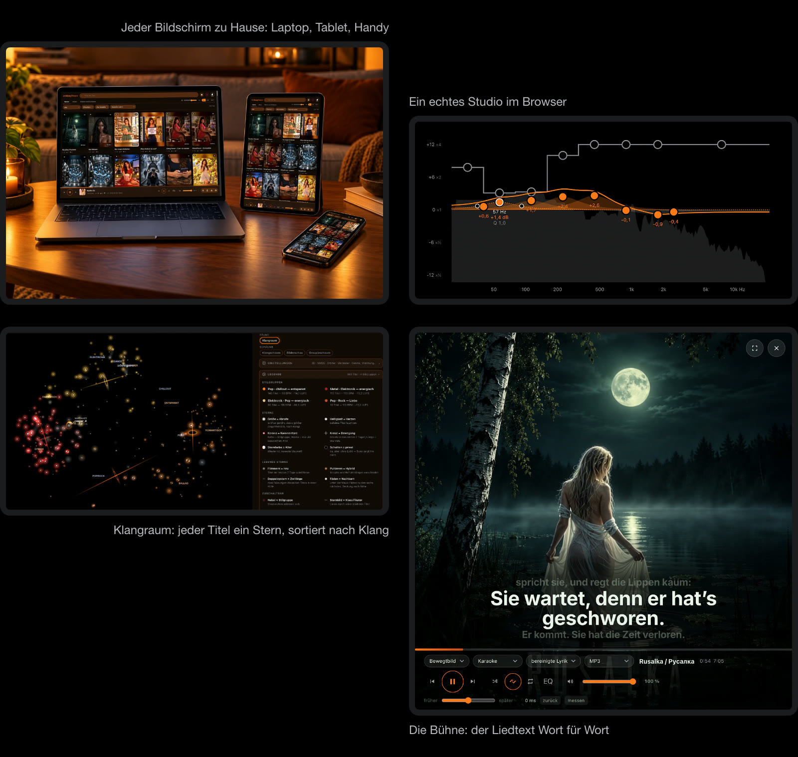

# KlangTresor #

**Deutsch** · [English](README.md) · [Русский](README.ru.md)

<a href="https://caspardavi.github.io/klangtresor/features/?lang=de"></a>

**[Was KlangTresor kann → Feature-Seite](https://caspardavi.github.io/klangtresor/features/?lang=de)**\
Broschüre als PDF: [für den Bildschirm (8 MB)](https://caspardavi.github.io/klangtresor/features/KlangTresor-Broschuere-de.pdf) · [zum Drucken (70 MB)](https://github.com/CasparDavi/klangtresor/releases/download/broschuere-2026-10-28/KlangTresor-Broschuere-de-druck.pdf)

*Ein Tresor für die eigene Musik — was drin liegt, gehört dir, und den
Schlüssel hast nur du.*

**Ein lokales Archiv der eigenen [Suno](https://suno.com)-Songs** — mit
Lyrics, Prompts, Artworks, Playlists und Metadaten. Dazu eine Website,
die im Heimnetz läuft und auf jedem Bildschirm mit Browser spielt.

<br>

<a href="https://caspardavi.github.io/klangtresor/features/?lang=de"></a>

<br>


Dahinter steckt ein Werkzeugkasten, der aus den eigenen Stücken liest,
was sich messen lässt: Lautheit nach EBU R128, Tonart aus dem Bass,
Stimmlage, Instrumentspuren, ein Tonstudio mit Equalizer und
Kompressor, eine Sternenkarte des eigenen Klangraums.

**Läuft mit Node-Bordmitteln.** Keine Datenbank, keine Anmeldung außer
der eigenen im Browser, eine einzige npm-Abhängigkeit (und die nur für
die Musikstil-Erkennung).

---

> **Die Dokumente liegen nach Modulen sortiert** — die Karte dazu steht in
> [docs/LIESMICH.md](docs/LIESMICH.md).

## Was das hier *nicht* ist

Damit keine Missverständnisse entstehen:

- **Kein Suno-Client und keine API-Umgehung.** Was ohne Anmeldung
  öffentlich abrufbar ist, wird öffentlich abgerufen. Alles Weitere —
  private Songs, Wort-Zeitmarken, Playlists — holt ein Lesezeichen im
  eigenen, bei Suno angemeldeten Browsertab. Der Zugang bleibt dort,
  wo er hingehört: bei suno.com.
- **Kein Weg an Sunos Bedingungen vorbei.** Das Archiv sichert die
  eigenen Werke, nicht fremde.
- **Kein Dienst.** Es läuft auf dem eigenen Rechner, im eigenen Netz,
  ohne Konto und ohne Server im Internet.
- **Keine fertige Anwendung.** Gebaut für ein Archiv und daran
  gewachsen. Wer es benutzen will, sollte mit einer Kommandozeile
  umgehen können.

---

## Rechte und Mitarbeit

Der Code steht unter der **MIT-Lizenz** — siehe [LICENSE](LICENSE). Das
heißt: Nimm ihn, ändere ihn, gib ihn weiter, baue etwas Eigenes daraus.
Die einzige Bedingung ist, daß der Urhebervermerk mitreist.

**Caspar_D behält das letzte Wort** darüber, was in dieses Projekt
einfließt. Das ist keine Lizenzbedingung, sondern schlicht die Folge
davon, wem das Repositorium gehört: Vorschläge sind willkommen,
zusammengeführt wird, was er zusammenführt. Wer es anders haben will,
darf jederzeit forken — dafür ist die Lizenz da.

Nicht unter dieser Lizenz stehen die fremden Bausteine und die
KI-Modelle. Was von wem stammt und was dabei zu beachten ist, steht in
[web/fremd/LIZENZEN.md](web/fremd/LIZENZEN.md). Eine Einschränkung
lohnt hervorgehoben zu werden: Die Modelle zur Musikstil-Erkennung
stehen unter CC BY-NC-ND und dürfen nicht kommerziell benutzt werden.

Die Songs, Texte und Artworks in einem damit gebauten Archiv gehören
ihren Urhebern und sind nicht Teil dieses Repositoriums.

## Wie das hier entstanden ist

Große Teile dieses Codes sind im Dialog mit einem KI-Sprachmodell
geschrieben worden. Entwurf, Auswahl, Prüfung und alle
Gestaltungsentscheidungen stammen von Caspar_D — nachzulesen in
[docs/haus/HAUSREGELN.md](docs/haus/HAUSREGELN.md), wo jede Regel mit ihrem Anlaß
steht, und in der Versionsgeschichte.

Das steht hier, weil es zutrifft und weil die Dokumente ohnehin davon
erzählen. Wer wissen will, wie so etwas zustande kommt, findet in
[docs/haus/HISTORY.md](docs/haus/HISTORY.md) auch die Irrwege.

---

## Was es kann

**Archiv**
- Alle eigenen Songs lokal — MP3 und WAV, Artwork, Video-Artworks
- Playlists samt Reihenfolge; fremde Songs darin laufen vom CDN
- Auch Unveröffentlichtes, sofern es in einer eigenen Playlist steht
- Kommentare und Reaktionen mit den Menschen dahinter

**Hören**
- Karaoke-Bühne mit wortgenau mitlaufendem Text und Vollbild
- Farbpaletten aus jedem Cover — die Oberfläche färbt sich nach dem
  laufenden Song, ohne je eine Farbe zu erfinden
- Sieben eigene Visualisierungen, dazu Butterchurn mit 333
  MilkDrop-Presets

**Messen**
- Lautheit nach EBU R128 mit beiden Toren, True Peak, Dynamikumfang
- Tonart aus dem Baß auf der Eins, Tongeschlecht aus der gezählten
  Terz — und wo keine Terz vorkommt, steht nur der Grundton
- Stimmlage per YIN auf der getrennten Gesangsspur
- Trennung in sechs Instrumentspuren, lokal und ohne Python
- Wort-Zeitmarken und Transkript aus whisper.cpp

**Werkzeuge**
- Tonstudio mit Equalizer, Kompressor, Raum und Störfrequenz-Kerbe
- **Räume**: die eigene Sammlung als Sternenkarte, mit Flugbahnen — in
  zwei Sichten. Der **Klang-Raum** ordnet nach dem Ton, der
  **Geschichten-Raum** nach dem, wovon die Lieder handeln (aus den
  Texten, mehrsprachig — deutsche und englische landen im selben Raum,
  ohne Übersetzung). Seine Gruppen heißen nach den **Ortsbegriffen**:
  den Wörtern des eigenen Bestands, die dort wohnen, wo die Gruppe
  liegt — eine Gruppe ohne klaren Ort sagt das ehrlich
- Autorenseite: die eigenen Zahlen im Verhältnis zur Nachbarschaft —
  wer hier kommentiert, geliked oder gefolgt hat, mit öffentlichen
  Profilzahlen und Hirschfaktor. Samt Erklärung, warum in dieser
  Rechnung fast jeder im unteren Drittel steht

---

## Einrichten

Voraussetzung: [Node.js](https://nodejs.org) und
[ffmpeg](https://ffmpeg.org) (`brew install ffmpeg` auf dem Mac,
`apt install ffmpeg` unter Linux).

```bash
node bin/sammelskript.js
```

Das Skript nennt die Adresse, die in Chrome zu öffnen ist. Dort:
Rechtsklick → *Untersuchen* → *Console*, den Inhalt der erzeugten
Datei `browser/02-sammeln-aktuell.js` einfügen, Enter. Am Ende liegt
`suno-archiv-metadaten.json` im Download-Ordner.

```bash
mv ~/Downloads/suno-archiv-metadaten.json \
   library/roh/profil-$(date +%Y-%m-%d-%H-%M-%S).json
node bin/wiederherstellen.js
node server/server.js
```

`wiederherstellen.js` baut alles Weitere: Katalog, Medien, Kacheln,
Farbpaletten. Der Server nennt die Adressen für Heimnetz und iPhone.

**Der eigene Handle wird nirgends eingetragen.** Das Sammelskript liest
ihn aus der Adresse der Profilseite, auf der es läuft, und sortiert
fremde Songs danach aus.

### Unter Windows

Doppelklick auf **`einrichten-windows.cmd`** — der Rest läuft von
selbst: prüfen, was fehlt, Node.js und Pakete holen, Modelle holen, nach
dem Suno-Alias fragen, Songs sammeln, starten. Die Einrichtung öffnet
sich als Seite im Browser; geht keiner auf, läuft sie im Fenster als Text.

Die `.cmd` ruft `bin\anlasser.ps1` — die `.ps1` nicht selbst anklicken.
Windows lehnt sie auf vielen Rechnern ab, und das Fenster schließt sich,
bevor man die Meldung lesen kann — man hält das Programm dann für kaputt.
Die `.cmd` umgeht beides; sie hält das Fenster offen und erlaubt das
Skript nur für diesen einen Aufruf, ohne an den Systemeinstellungen etwas
zu ändern.

Fehlt ffmpeg, sagt das Skript, wie man es nachholt — mit `winget` in
einer Zeile, und für Rechner ohne `winget` Schritt für Schritt von Hand.

### Unter WSL

Läuft der Server in der Linux-Umgebung, muß auch der Browser dort
laufen — ein unter Windows gestarteter Chrome erreicht ihn nicht. Alles
andere funktioniert, nur das Lesezeichen findet den Server nicht.

---

## Der laufende Betrieb

Der rote Knopf oben rechts holt, was neu ist: erst zeigen, dann
übernehmen. Er braucht keine Anmeldung.

Für das, was nur mit Anmeldung sichtbar ist — Wort-Zeitmarken, private
Songs, Playlists, wer reagiert hat — gibt es das **Lesezeichen**. Es
läuft im eigenen Suno-Tab, sichert sofort und schickt die Ernte in
Paketen an den Server. Ein Zugangsschlüssel landet dabei nie auf der
Platte.

Die Zahlen der Nachbarschaft holen zwei Läufe, anzustoßen aus dem Panel
*Nachbarschaft* auf der Autorenseite oder von Hand:

```
node bin/community-profile.js    Profilzahlen der Leute, die hier vorkommen
node bin/community-hirsch.js     deren Hirschfaktoren (dauert deutlich länger)
```

Beide holen nur, was noch fehlt; ein zweiter Lauf kostet also nichts.
Sie lesen öffentlich und ohne Anmeldung — und halten sich dabei an die
Umgangsform aus [docs/haus/HAUSREGELN.md](docs/haus/HAUSREGELN.md): eine Anfrage
zur Zeit, 1,5 s Pause, ehrlicher User-Agent, und bei einer Bremse des
Dienstes sofort Schluß.

---

## Update einspielen

Der rote Knopf holt Songdaten, nicht den Code. Neue Versionen des Programms
liegen auf [GitHub](https://github.com/CasparDavi/klangtresor). Ob dort eine
neue liegt, sieht KlangTresor von selbst nach: beim Öffnen der Seite und,
solange sie offen ist, alle 12 Stunden (nach einem Fehlschlag nach 2
Stunden) fragt die Seite den eigenen Server — und jedes Mal, wenn das Fenster
„KlangTresor“ (Klick auf den Namen oben) aufgeht. Der Server fragt GitHub und
hält die Antwort eine halbe Stunde vor. Liegt dort eine höhere Nummer, steht
links neben dem roten Knopf eine Glocke; ein Klick öffnet das Fenster mit dem
Hinweis: welche Version bereitliegt, in welchem Ordner KlangTresor läuft und
welches Skript das Update einspielt. **Ordner zeigen** öffnet diesen Ordner im
Dateifenster (nur am Rechner, auf dem KlangTresor läuft, nicht im Container). Die eingefrorene
Kopie auf dem Stick fragt nie.

Zum Einspielen im **Projektordner** (dort liegen `bin/` und `library/`,
eine Ebene über `docker/`):

```bash
./aktualisieren-linux.sh          # Mac: aktualisieren-macos.command
                                  # Windows: aktualisieren-windows.cmd
```

Aus einem Unterordner: `npm run aktualisieren` (npm findet `package.json`
darüber). Nur nachsehen, nichts schreiben:

```bash
npm run aktualisieren -- --nur-stand
```

- **Git-Klon:** `git pull --rebase origin main` (bricht ab bei Schmutz
  oder anderem Zweig als `main`). Hineinkopierte Dateien aus dem
  Update-Paket halten den Zug nicht auf. Ist die Geschichte mit der auf
  GitHub nicht verwandt (ein Klon aus der MySuno-Zeit), kommt das
  Release-Zip; ungesicherte Änderungen liegen vorher im `git stash`.
- **Zip-Installation:** holt `KlangTresor.zip` der jüngsten Release und
  legt die Programmdaten darüber.
- **Docker:** danach `compose up --build`. `library/` ist Volume und
  bleibt. CUDA-Overlay nur, wenn der laufende Container `KLANG_CUDA`
  schon hat.
- **Ohne Docker:** bei geändertem `package-lock.json` ein `npm ci`, dann
  Server über `starten-*` neu starten.

`library/`, `werkzeug/` und `.git/` bleiben unangetastet.

---

## Ältere Versionen ohne Update-Skript

Bis Version 1.0.72 – und aus der Zeit, als das Programm *MySuno* hieß –
liegt im Ordner noch kein Update-Skript. Dafür hängt an jeder Release das
Update-Paket, immer in der jüngsten Version:

```
https://github.com/CasparDavi/klangtresor/releases/latest/download/KlangTresor-Update.zip
```

Kopiere `aktualisieren.js` und das Skript für dein System in deinen
KlangTresor- bzw. MySuno-Ordner (dort, wo `library/` liegt) und doppelklicke
das Skript:

| System | kopieren | starten |
|---|---|---|
| Windows | `aktualisieren.js`, `aktualisieren-windows.cmd` | Doppelklick auf `aktualisieren-windows.cmd` |
| macOS | `aktualisieren.js`, `aktualisieren-macos.command` | `aktualisieren-macos.command` doppelklicken |
| Linux | `aktualisieren.js`, `aktualisieren-linux.sh` | `./aktualisieren-linux.sh` |

Das Paket ist flach, ohne Unterordner: der Finder ersetzt beim Kopieren
einen vorhandenen Ordner `bin/`, statt ihn zusammenzuführen. Das Update
läuft dann wie gewohnt – `library/` bleibt –, danach liegen alle
`aktualisieren-*` im Ordner, und die Kopie `aktualisieren.js` räumt sich
selbst weg. Ab Version 1.0.73 ist das Paket nicht nötig.

Beim ersten Start meckert das System, das Paket ist nicht signiert:
Windows sagt „Der Herausgeber konnte nicht verifiziert werden“ –
**Ausführen**. macOS sagt „nicht verifizierter Entwickler“ – beim ersten
Mal Rechtsklick → **Öffnen**; ab macOS 15 gibt es das dort nicht mehr,
dann Systemeinstellungen → Datenschutz & Sicherheit → **Dennoch öffnen**.
Linux: fehlt das Ausführungsrecht, `chmod +x aktualisieren-linux.sh`.

Wer KlangTresor nur im Container betreibt, ohne Node auf dem Rechner,
braucht das Paket nicht: den Inhalt des neuen `KlangTresor.zip` in den
Ordner kopieren (Dateien ersetzen, nie den ganzen Ordner – `library/`
liegt darin) und `einrichten-docker-*` noch einmal. Läuft dort noch der
Container `mysuno` aus der MySuno-Zeit, vorher `docker stop mysuno`.

---

## Wer schon eine Installation hat

Das Programm hieß bis zum 24.08.2026 *MySuno*. Das Update spielt man ein
wie unter [Ältere Versionen ohne Update-Skript](#ältere-versionen-ohne-update-skript)
beschrieben, es geht nichts verloren:

- **Einstellungen bleiben.** Equalizer, Lautstärke, Darstellungsart,
  Kartenansicht — alle 52 Speicherschlüssel im Browser heißen weiter wie
  vorher. Sie umzubenennen hätte bei jedem Nutzer alles zurückgesetzt,
  und nach außen kennzeichnen sie nichts.
- **Das Archiv bleibt.** `library/` wird nicht angefaßt, das Ablageformat
  ist unverändert, kein Serverendpunkt ist weggefallen.
- **Das Verzeichnis darf heißen, wie es heißt.** Alle Skripte arbeiten
  relativ zu sich selbst; niemand muß etwas umbenennen.

Zwei Dinge ändern sich sichtbar:

**Die Analysen werden einmal neu gerechnet.** Seit dem Ausbau des alten
Tonartverfahrens tragen die Ablagen einen Meßweg-Stempel. Wer noch
Analysen von davor hat, bekommt sie beim nächsten Öffnen neu — einmalig,
danach ist Ruhe.

**Fünf Darstellungsarten sind fort.** `audioMotion` stand unter AGPL und
verträgt sich nicht mit der MIT-Lizenz dieses Projekts. Wer eine seiner
Arten eingestellt hatte, wird beim nächsten Start auf **Spektrum**
umgeschrieben — dieselben Frequenzbalken, nur radial statt auf einer
Grundlinie.

Nach dem Aktualisieren den Server einmal neu starten.

---

## Was gesichert werden muß

**`library/katalog.json.gz`** — rund 47 MB. Dort steckt alles, was
nicht aus einer Datei zurückkommt: Lyrics, Wort-Zeitmarken, Kommentare
mit ihren Antworten, der Zählerverlauf über Monate, die Playlists.

Dazu `library/roh/`, falls dort gerade etwas liegt.

> **Achtung, diese Anweisung stand hier lange falsch.** Sie nannte
> `library/roh/` als das einzig Unersetzliche. Das stimmte einmal —
> heute räumt `aufbereiten.js` die verarbeiteten Rohdaten weg, sobald
> ihr Inhalt im Katalog steht (so gewollt: „wozu das mitführen und
> Speicherplatz vergeuden"). Der Ordner ist im gesunden Betrieb also
> fast leer, und wer nur ihn sichert, sichert nichts.

Alles Übrige — Medien, Artworks, Kacheln, Paletten, Analysen — baut
`node bin/wiederherstellen.js` neu auf, ohne jede Anmeldung.

**Zwei Dinge holt es aber nicht zurück:** die WAV-Originale
(`node bin/wav.js` — **seit dem 03.09.2026 außer Betrieb**, der Weg über
`cdn1.suno.ai` ist zu, siehe `docs/suno/AUDIO-BEZUG.md`) und die
Instrumentspuren (die rechnet der Morgenlauf neu, höchstens eine halbe Stunde je Morgen, neueste zuerst). Wer
die behalten will, sichert `library/songs/` gleich mit — das sind dann
allerdings zig Gigabyte.

---

## Verzeichnis

```
einrichten-windows.cmd         Einrichten unter Windows (Doppelklick)
einrichten-macos.command       Einrichten auf dem Mac (Doppelklick)
einrichten-linux.sh            Einrichten unter Linux
einrichten-docker-*            dasselbe, ohne Installation - alles im Container
aktualisieren-*                Update auf die neue Version von GitHub (Git oder Zip)
starten-windows.cmd / -macos.command / -linux.sh   nur starten, nicht einrichten
docker/    Dockerfile, docker-compose.yml, Einstiegsskript des Containers
bin/       Sammeln, Aufbereiten, Messen, Farben, Wiederherstellen
  einrichten.js  die Einrichtung in zehn Schritten; melden.js liefert ihr die Zahlen
browser/   Skripte für die Suno-Konsole und das Lesezeichen
server/    Website fürs Heimnetz, Port 8788
web/       die gesamte Oberfläche in einer Datei
  einrichtung/  die Seite der Einrichtung (Balken, Haken, Ergebniszahlen)
  fremd/   Analyzer, Butterchurn
library/   Katalog, Rohdaten, Medien — nicht im Repo
docs/      Fachdokumente
```

---

## Dokumentation

| | |
|---|---|
| [docs/archiv/UEBERGABE.md](https://github.com/CasparDavi/klangtresor/blob/main/docs/archiv/UEBERGABE.md) | Einstieg, Abläufe, Fallstricke |
| [docs/haus/HAUSREGELN.md](docs/haus/HAUSREGELN.md) | Die Gestaltungsregeln, jede mit ihrem Anlaß |
| [docs/analyse/NORMEN.md](docs/analyse/NORMEN.md) | Lautheitsnormen, Tore, Zielpegel |
| [docs/analyse/VISUALIZER.md](docs/analyse/VISUALIZER.md) | Bühne, Analyse, Darstellungsregeln |
| [docs/analyse/FARBHANDLING.md](docs/analyse/FARBHANDLING.md) | Farbextraktion, Farbräume, jede Regel mit Meßwert |
| [docs/ton/TONSTUDIO.md](docs/ton/TONSTUDIO.md) | Equalizer, Kompressor, Raum |
| [docs/ton/EINMESSEN.md](docs/ton/EINMESSEN.md) | Einmessen am Hörplatz: Signale, Ablauf, Auswertung, Befunde |
| [docs/suno/WHISPER.md](docs/suno/WHISPER.md) | Wort-Zeitmarken aus dem Hören |
| [docs/suno/WEGE.md](docs/suno/WEGE.md) | Die Wege der Web-API — was wir nutzen, was lohnt, was das Konto verändert |
| [docs/forschung/VERGLEICH-HUB.md](docs/forschung/VERGLEICH-HUB.md) | Funktionsvergleich mit einem verwandten Werkzeug — haben wir das, besser, oder verworfen? |
| [docs/haus/ZUSAMMENARBEIT.md](docs/haus/ZUSAMMENARBEIT.md) | Zu zweit am Repo: fremde Commits prüfen, bevor gezogen wird |
| [docs/BACKLOG.md](https://github.com/CasparDavi/klangtresor/blob/main/docs/BACKLOG.md) | Was offen ist — und was verworfen wurde, mit Begründung |
| [docs/haus/HISTORY.md](docs/haus/HISTORY.md) | Chronologie einschließlich aller Irrwege |

Die Fachdokumente sind am Archiv ihres Autors
([@caspar_d](https://suno.com/@caspar_d)) entstanden und nennen dessen
Meßwerte und Beispiele. Sie beschreiben trotzdem das Programm, nicht
die Sammlung — die Zahlen sind Belege für die getroffenen
Entscheidungen.

Wer wissen will, warum etwas so gebaut ist und nicht anders, findet die
Antwort meist als Kommentar an Ort und Stelle im Quelltext. Das ist
Absicht: Begründungen wandern nicht in eine Datei, die niemand
aufschlägt.

---

## Grenzen

- **Entwickelt auf macOS** mit Chrome und Safari; unter Linux und WSL
  von Testern gelaufen.
- Die Sammelskripte hängen an Sunos Schnittstellen. Ändert Suno etwas,
  hilft `browser/01-erkundung.js` beim Nachziehen.
- Auf exFAT-Platten belegt jede kleine Datei einen vollen 1-MB-Block —
  deshalb liegt aller Kleinkram in Sammeldateien.
- Die Stem-Trennung braucht ein Modell von 246 MB
  (`npm run modelle`) und rechnet in etwa doppelter Echtzeit.

---

## Zum Namen

Das Projekt hieß bis zum 24.08.2026 *MySuno*. Der Name ist gefallen,
weil **SUNO** seit dem 06.01.2026 eingetragene Marke von Suno Inc. ist
([US-Reg. 8096778](https://tsdr.uspto.gov/statusview/sn98407583)) — und
zwar ausdrücklich für *„downloadable software to enable users to edit
and playback of audio content"*, also für genau diese Art Programm. Die
internationale Registrierung IR 1930809 vom 22.05.2026 benennt auch
Deutschland und die EU.

Eine fremde Marke im **Namen** eines Projekts ist heikel; sie in der
**Beschreibung** zu nennen, ist es nicht — deshalb steht oben weiterhin,
wofür das hier gut ist. Wo in Zitaten und in `docs/haus/HISTORY.md` noch der
alte Name steht, bleibt er stehen: Was einmal gesagt wurde, schreibt man
nicht nachträglich um.

Auch die Speicherschlüssel im Browser (`mysuno-…`), die CSS-Klasse
`.sunoanalyzer` und `window.SunoAnalyzer` tragen weiter den alten Namen.
Sie umzubenennen würde bei jedem Nutzer die gespeicherten Einstellungen
wegwerfen, und nach außen kennzeichnen sie nichts.
