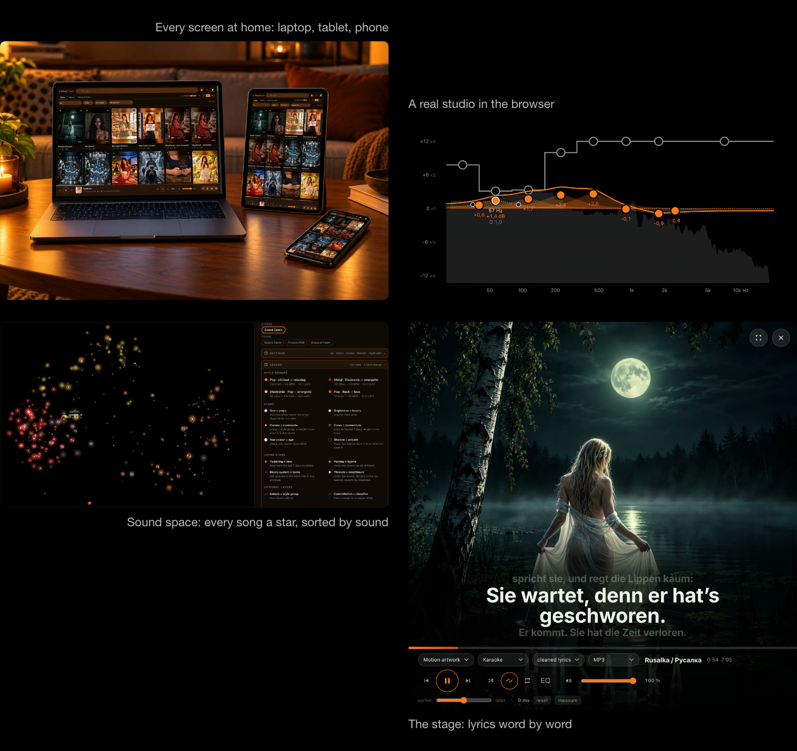

<a href="https://caspardavi.github.io/klangtresor/features/"></a>

<p align="center"><a href="README.de.md">Deutsch</a> · <b>English</b> · <a href="README.ru.md">Русский</a></p>

# KlangTresor

**Your Suno music. At home.**
Suno makes the songs. KlangTresor keeps them, plays them, measures them and shows them — on every screen in your home.
Free and open source. No account. Runs on your own computer.

**[See everything it can do → feature page](https://caspardavi.github.io/klangtresor/features/)** · Brochure (PDF): [for screens, 8 MB](https://caspardavi.github.io/klangtresor/features/KlangTresor-Broschuere-en.pdf) · [for print, 70 MB](https://github.com/CasparDavi/klangtresor/releases/download/broschuere-2026-10-28/KlangTresor-Broschuere-en-druck.pdf)

## Download

<p align="center">
<a href="https://github.com/CasparDavi/klangtresor/releases/latest/download/KlangTresor-Setup.exe"></a>
<a href="https://github.com/CasparDavi/klangtresor/releases/latest/download/KlangTresor.dmg"></a>
<a href="https://github.com/CasparDavi/klangtresor/releases/latest/download/KlangTresor-x86_64.AppImage"></a>
<br><sub>Setup.exe 87 MB · DMG 164 MB (Intel and Apple Silicon) · AppImage 109 MB</sub>
</p>

**System requirements.** A 64-bit computer with Windows 10 or 11, macOS 11 or newer, or Linux (x86_64). About 5 GB
of free space for the program and the AI models, plus about 15 MB per song (about 70 MB with the WAV original).
A current browser — for the full feature set **Google Chrome**; for listening, any phone, tablet or TV in your home
network will do.

## What it does

<a href="https://caspardavi.github.io/klangtresor/features/"></a>

- **Your archive.** Every song you made on Suno — MP3 and WAV, lyrics, covers, moving covers, playlists, comments
  and hearts — in a folder on your own computer.
- **A stage for every song.** Karaoke with lyrics that follow word by word, visualisations that take their colours
  from the cover, full screen on the TV.
- **A real studio in the browser.** Eight-band equaliser, compressor and room, calibrated at your listening position.
- **A look inside your songs.** Loudness, key, vocal range, six separated instrument tracks — and a star map that
  sorts your whole collection by sound or by what the songs are about.
- **Make something of it.** Poster studio for your complete works, effect clips from a still cover, export to a
  USB stick or a music folder for the car.

## Getting started

1. **Download and open** the file for your system. The installers are not signed yet, so the first launch asks for
   confirmation once:
   - **Windows:** "Windows protected your PC" → *More info* → *Run anyway*. Edge may ask to *Keep* the download first.
   - **macOS:** if it is blocked, System Settings → Privacy & Security → *Open Anyway*.
   - **Linux:** right-click → Properties → allow *Executable as Program*, then double-click. No sudo.

   [START-HERE.md](START-HERE.md) shows every click with pictures.
2. **Setup runs in your browser.** It fetches ffmpeg and the AI models with progress bars, then asks for your Suno
   name and collects your public songs.
3. **KlangTresor runs as an icon** in the taskbar, Dock or panel. The page is at **http://localhost:8788**. For
   phones, tablets and TVs on the same Wi-Fi, *Profile → On your phone* shows the address and a QR code.
4. **Private songs, albums and word timestamps** need your Suno login. KlangTresor never sees your password: a
   bookmark you click in your own Suno tab sends them over. Its address is in the morning window behind the red
   button.

Afterwards the **red button** at the top right fetches what is new.

## Updates and backup

- **Updates:** when a new version is out, a bell appears next to the red button. One click installs it in the app;
  running a newer installer does the same. Your archive is never touched.
- **Backup:** back up **`library/katalog.json.gz`** in your KlangTresor folder. It holds what cannot be fetched again —
  lyrics, word timestamps, comments, playlists, the counter history. Everything else (media, covers, analyses) is
  rebuilt by `node bin/wiederherstellen.js`. Instrument tracks are recomputed by the morning run; WAV originals do not
  come back, so keep `library/songs/` too if you want them.

## Your data

Your songs stay on your computer. KlangTresor has no account, no cloud and no tracking. It goes online only to fetch
your own songs from Suno, to download its tools and models during setup, and to ask GitHub whether there is a new
version.

## Questions

<details><summary><b>My phone cannot open the page.</b></summary>

Phone and computer must be on the same Wi-Fi. On the first start your computer's firewall asks whether Node may
accept connections — allow it.
</details>

<details><summary><b>Windows or macOS says the app is unsafe.</b></summary>

The installers are not signed yet. Confirm once as described under [Getting started](#getting-started).
</details>

<details><summary><b>"Port 8788 is already in use".</b></summary>

Another KlangTresor is already running. Quit it via its icon, or open http://localhost:8788 to see whether that is
the archive you meant.
</details>

<details><summary><b>Some downloads failed during setup.</b></summary>

Setup says what is missing and offers to try again. KlangTresor runs without it; missing models can be fetched
later under *Profile → System*.
</details>

<details><summary><b>How do I uninstall it?</b></summary>

Windows: Settings → Apps → KlangTresor. macOS: drag the app to the Bin. Linux: delete the AppImage. Your archive and
the AI models stay in the `KlangTresor` folder in your home folder — delete it if you want everything gone.
</details>

## Good to know

- **Not a Suno client.** What is public is fetched publicly; everything else is fetched in your own signed-in Suno
  tab. It only collects your own songs.
- **Not affiliated with Suno Inc.** Suno is a trademark of Suno Inc. The program was called *MySuno* until August 2026.
- **It follows Suno.** If Suno changes its website, the morning run may need a new version. Everything already at
  home stays playable.
- **Tested** on Windows 10 and 11, macOS 26 (Intel) and Ubuntu 24.04. Apple Silicon is built in but not yet tested on
  a real device.

## Licence

The code is released under the **MIT licence** ([LICENSE](LICENSE)): use it, change it, pass it on. Third-party
components and AI models keep their own licences — see [web/fremd/LIZENZEN.md](web/fremd/LIZENZEN.md). Note: the
models for music-style detection are licensed CC BY-NC-ND and must not be used commercially. The songs, lyrics and
covers in an archive belong to their creators.

KlangTresor is made by Caspar_D with Tarja, Casto and Henry. Large parts of the code were written in dialogue with an
AI language model; design and decisions are Caspar_D's ([docs/haus/HAUSREGELN.md](docs/haus/HAUSREGELN.md)).

<details><summary><b>Other ways to install</b> — zip, Docker, Git, WSL</summary>

- **Zip:** download `KlangTresor.zip` from the [latest release](https://github.com/CasparDavi/klangtresor/releases/latest),
  unpack it and double-click `einrichten-windows.cmd`, `einrichten-macos.command` or `einrichten-linux.sh`.
- **Docker:** the same with `einrichten-docker-*` — everything runs in a container, `library/` stays on your disk.
- **Git:** `git clone https://github.com/CasparDavi/klangtresor && cd klangtresor && npm ci && npm start`.
- **Updating** these installations: the bell in the app, or `aktualisieren-*` in the program folder.
- **WSL:** the browser must run inside WSL too, otherwise the bookmark cannot reach the server.

Details: [docs/INSTALL-ADVANCED.md](docs/INSTALL-ADVANCED.md).
</details>

<details><summary><b>Coming from MySuno or version 1.0.72 and older</b></summary>

These versions have no update script yet. Copy `aktualisieren.js` and the script for your system from
[KlangTresor-Update.zip](https://github.com/CasparDavi/klangtresor/releases/latest/download/KlangTresor-Update.zip)
into the folder that contains `library/` and run it. Archive and settings stay; analyses are recalculated once.
Details: [docs/MIGRATION-MYSUNO.md](docs/MIGRATION-MYSUNO.md).
</details>

<details><summary><b>For developers</b></summary>

```
git clone https://github.com/CasparDavi/klangtresor && cd klangtresor && npm ci
npm start                      # server/server.js → http://localhost:8788
```

Node 20 or newer; two dependencies (`onnxruntime-node`, `umap-js`). Layout: `server/` the home-network server ·
`web/` the interface · `bin/` collecting, measuring, setup, update · `browser/` the bookmarklet · `docker/`.
Installers: `node bin/paket.js` builds zip, Setup.exe, AppImage and DMG.

| | |
|---|---|
| [docs/LIESMICH.md](docs/LIESMICH.md) | Map of all documents (German) |
| [docs/haus/HAUSREGELN.md](docs/haus/HAUSREGELN.md) | Design rules, each with its occasion |
| [docs/analyse/NORMEN.md](docs/analyse/NORMEN.md) | Loudness standards, gates, target levels |
| [docs/analyse/FARBHANDLING.md](docs/analyse/FARBHANDLING.md) | Colour extraction and colour spaces |
| [docs/ton/TONSTUDIO.md](docs/ton/TONSTUDIO.md) | Equaliser, compressor, room |
| [docs/suno/WHISPER.md](docs/suno/WHISPER.md) | Word timestamps from listening |
| [docs/BACKLOG.md](docs/BACKLOG.md) | What is open, and what was discarded |
| [docs/haus/HISTORY.md](docs/haus/HISTORY.md) | Chronology, including the detours and the name change |

Why something is built the way it is usually stands as a comment right in the source code.
</details>
