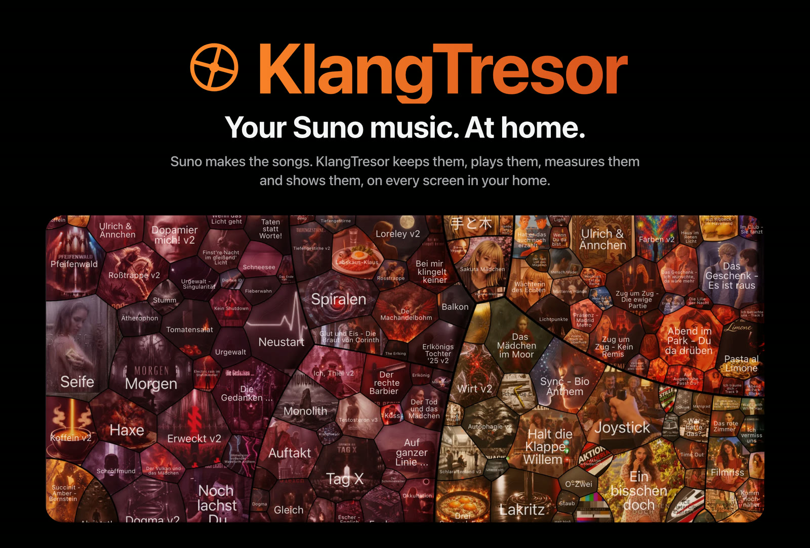

# KlangTresor #

[Deutsch](README.de.md) · **English** · [Русский](README.ru.md)

<a href="https://caspardavi.github.io/klangtresor/features/"></a>

**[What KlangTresor can do → feature page](https://caspardavi.github.io/klangtresor/features/)**

*A vault for your own music — what lies inside is yours, and only you
hold the key.*

**A local archive of your own [Suno](https://suno.com) songs** — with
lyrics, prompts, artworks, playlists and metadata. Plus a website that
runs on your home network and plays on every screen with a browser.

Behind it sits a toolbox that reads from your own tracks what can be
measured: loudness according to EBU R128, key from the bass, vocal
range, instrument tracks, a sound studio with equaliser and
compressor, a star map of your own sound space.

**Runs on Node's built-in tools.** No database, no sign-in except your
own in the browser, a single npm dependency (and that only for music
style detection).

---

> **The documents are sorted by module** — the map to them is in
> [docs/LIESMICH.md](docs/LIESMICH.md) (German).

## What this is *not*

To avoid any misunderstanding:

- **Not a Suno client and no workaround for the API.** What is publicly
  available without signing in is fetched publicly. Everything else —
  private songs, word timestamps, playlists — is fetched by a bookmarklet
  in your own browser tab, where you are signed in to Suno. Access stays
  where it belongs: at suno.com.
- **No way around Suno's terms.** The archive secures your own works,
  not other people's.
- **Not a service.** It runs on your own computer, on your own network,
  without an account and without a server on the internet.
- **Not a finished application.** It was built for one archive and grew
  with it. Anyone who wants to use it should be comfortable with a
  command line.

---

## Rights and contributing

The code is released under the **MIT licence** — see [LICENSE](LICENSE). That
means: take it, change it, pass it on, build something of your own from
it. The only condition is that the copyright notice travels with it.

**Caspar_D has the final say** over what flows into this project. That is
not a licence condition, but simply the consequence of whom the
repository belongs to: suggestions are welcome, and what gets merged is
what he merges. Anyone who wants it differently is welcome to fork at any
time — that is what the licence is for.

Not covered by this licence are the third-party components and the AI
models. What comes from whom and what to watch out for is listed in
[web/fremd/LIZENZEN.md](web/fremd/LIZENZEN.md). One restriction is worth
highlighting: the models for music style detection are licensed under
CC BY-NC-ND and must not be used commercially.

The songs, lyrics and artworks in an archive built with it belong to
their creators and are not part of this repository.

## How this came about

Large parts of this code were written in dialogue with an AI language
model. Design, selection, review and all design decisions come from
Caspar_D — see
[docs/haus/HAUSREGELN.md](docs/haus/HAUSREGELN.md), where every rule is
listed with its occasion, and the version history.

This is stated here because it is true and because the documents talk
about it anyway. Anyone who wants to know how something like this comes
about will also find the detours in
[docs/haus/HISTORY.md](docs/haus/HISTORY.md).

---

## What it can do

**Archive**
- All your own songs locally — MP3 and WAV, artwork, video artworks
- Playlists with their order; other people's songs in them play from the CDN
- Unpublished songs too, as long as they are in one of your own playlists
- Comments and reactions, with the people behind them

**Listening**
- Karaoke stage with lyrics that follow word by word, and full screen
- Colour palettes from every cover — the interface takes its colours from
  the song that is playing, without ever inventing a colour
- Seven visualisations of its own, plus Butterchurn with 333
  MilkDrop presets

**Measuring**
- Loudness according to EBU R128 with both gates, true peak, loudness range
- Key from the bass on the downbeat, mode from the counted third — and
  where no third occurs, only the root note is shown
- Vocal range via YIN on the separated vocal track
- Separation into six instrument tracks, local and without Python
- Word timestamps and transcript from whisper.cpp

**Tools**
- Sound studio with equaliser, compressor, room and a notch for
  interfering frequencies
- **Spaces**: your own collection as a star map, with flight paths — in
  two views. The **Sound Space** arranges by sound, the **Story Space**
  by what the songs are about (from the lyrics, multilingual — German and
  English ones end up in the same space, without translation). Its groups
  are named after the **place words**: the words of your own collection
  that live where the group lies — a group without a clear place says so
  honestly
- Author page: your own numbers in relation to the neighbourhood — who
  here has commented, liked or followed, with public profile figures and
  h-index. Including an explanation of why almost everyone lands in the
  lower third in this calculation

---

## Setting up

Requirements: [Node.js](https://nodejs.org) and
[ffmpeg](https://ffmpeg.org) (`brew install ffmpeg` on the Mac,
`apt install ffmpeg` on Linux).

```bash
node bin/sammelskript.js
```

The script names the address to open in Chrome. There: right-click →
*Inspect* → *Console*, paste the contents of the generated file
`browser/02-sammeln-aktuell.js`, press Enter. In the end,
`suno-archiv-metadaten.json` is in your Downloads folder.

```bash
mv ~/Downloads/suno-archiv-metadaten.json \
   library/roh/profil-$(date +%Y-%m-%d-%H-%M-%S).json
node bin/wiederherstellen.js
node server/server.js
```

`wiederherstellen.js` builds everything else: catalogue, media, tiles,
colour palettes. The server names the addresses for the home network and
iPhone.

**Your own handle is entered nowhere.** The collection script reads it
from the address of the profile page it runs on, and sorts out other
people's songs accordingly.

### On Windows

Double-click **`einrichten-windows.cmd`** — the rest runs by itself:
check what is missing, fetch Node.js and packages, fetch models, ask for
your Suno alias, collect songs, start. The setup opens as a page in the
browser; if none opens, it runs in the window as text.

The `.cmd` calls `bin\anlasser.ps1` — do not click the `.ps1` itself.
On many computers Windows refuses it, and the window closes before you
can read the message — you then take the program for broken. The `.cmd`
avoids both; it keeps the window open and allows the script only for this
one call, without changing anything in the system settings.

If ffmpeg is missing, the script tells you how to get it — with `winget`
in one line, and for computers without `winget` step by step by hand.

### On WSL

If the server runs in the Linux environment, the browser must run there
too — a Chrome started under Windows cannot reach it. Everything else
works, only the bookmarklet does not find the server.

---

## Day-to-day operation

The red button at the top right fetches what is new: first show, then
apply. It needs no sign-in.

For what is only visible when signed in — word timestamps, private songs,
playlists, who has reacted — there is the **bookmarklet**. It runs in your
own Suno tab, saves immediately and sends the harvest to the server in
packets. An access key never lands on the disk in the process.

The neighbourhood figures are fetched by two runs, to be started from the
*Neighbourhood* panel on the author page or by hand:

```
node bin/community-profile.js    Profile figures of the people who appear here
node bin/community-hirsch.js     their h-indexes (takes considerably longer)
```

Both fetch only what is still missing; a second run therefore costs
nothing. They read publicly and without sign-in — and keep to the
etiquette from [docs/haus/HAUSREGELN.md](docs/haus/HAUSREGELN.md): one
request at a time, a 1.5 s pause, an honest user agent, and stopping
immediately if the service puts on the brakes.

---

## Installing an update

The red button fetches song data, not the code. New versions of the
program are on [GitHub](https://github.com/CasparDavi/klangtresor).
KlangTresor checks by itself whether a new one is there: when the page is
opened and, as long as it stays open, every 12 hours (2 hours after a
failure) the page asks your own server — and every time the
"KlangTresor" window opens (click on the name at the top). The server asks
GitHub and keeps the answer for half an hour. If a higher number is there,
a bell appears to the left of the red button; a click opens the window
with the notice: which version is available, in which folder KlangTresor
is running and which script installs the update. **Show folder** opens
that folder in the file window (only on the computer where KlangTresor
runs, not in the container). The frozen copy on the stick never asks.

To install, in the **project folder** (where `bin/` and `library/` are,
one level above `docker/`):

```bash
./aktualisieren-linux.sh          # Mac: aktualisieren-macos.command
                                  # Windows: aktualisieren-windows.cmd
```

From a subfolder: `npm run aktualisieren` (npm finds the `package.json`
above). To only look, without writing anything:

```bash
npm run aktualisieren -- --nur-stand
```

- **Git clone:** `git pull --rebase origin main` (aborts on a dirty
  working tree or a branch other than `main`). Files copied in from the
  update package do not hold up the pull. If the history is unrelated to
  the one on GitHub (a clone from the MySuno days), the release zip is
  used instead; uncommitted changes are put in `git stash` beforehand.
- **Zip installation:** fetches `KlangTresor.zip` of the latest release
  and lays the program files over the existing ones.
- **Docker:** then `compose up --build`. `library/` is a volume and
  stays. CUDA overlay only if the running container already has
  `KLANG_CUDA`.
- **Without Docker:** if `package-lock.json` has changed, run `npm ci`,
  then restart the server via `starten-*`.

`library/`, `werkzeug/` and `.git/` are left untouched.

---

## Older versions without an update script

Up to version 1.0.72 — and from the time when the program was called
*MySuno* — the folder does not yet contain an update script. For that,
every release has the update package attached, always in the latest
version:

```
https://github.com/CasparDavi/klangtresor/releases/latest/download/KlangTresor-Update.zip
```

Copy `aktualisieren.js` and the script for your system into your
KlangTresor or MySuno folder (where `library/` is) and double-click the
script:

| System | copy | start |
|---|---|---|
| Windows | `aktualisieren.js`, `aktualisieren-windows.cmd` | double-click `aktualisieren-windows.cmd` |
| macOS | `aktualisieren.js`, `aktualisieren-macos.command` | double-click `aktualisieren-macos.command` |
| Linux | `aktualisieren.js`, `aktualisieren-linux.sh` | `./aktualisieren-linux.sh` |

The package is flat, without subfolders: when copying, the Finder replaces
an existing `bin/` folder instead of merging it. The update then runs as
usual — `library/` stays —, after which all `aktualisieren-*` files are in
the folder, and the copy `aktualisieren.js` removes itself. From version
1.0.73 on, the package is not needed.

On the first start the system complains that the package is not signed:
Windows says "The publisher could not be verified" — **Run**. macOS says
"unverified developer" — the first time, right-click → **Open**; from
macOS 15 on that is no longer offered there, then System Settings →
Privacy & Security → **Open Anyway**. Linux: if the execute permission is
missing, `chmod +x aktualisieren-linux.sh`.

Anyone who runs KlangTresor only in the container, without Node on the
computer, does not need the package: copy the contents of the new
`KlangTresor.zip` into the folder (replace files, never the whole folder —
`library/` is inside it) and run `einrichten-docker-*` once more. If the
container `mysuno` from the MySuno days is still running there, first run
`docker stop mysuno`.

---

## If you already have an installation

The program was called *MySuno* until 24 Aug 2026. You install the update
as described under
[Older versions without an update script](#older-versions-without-an-update-script);
nothing is lost:

- **Settings stay.** Equaliser, volume, display mode, map view — all 52
  storage keys in the browser keep their names. Renaming them would have
  reset everything for every user, and outwardly they mark nothing.
- **The archive stays.** `library/` is not touched, the storage format is
  unchanged, no server endpoint has been dropped.
- **The directory may keep its name.** All scripts work relative to
  themselves; nobody has to rename anything.

Two things change visibly:

**The analyses are recalculated once.** Since the old key-detection method
was removed, the stores carry a measurement-path stamp. Anyone who still
has analyses from before gets them recalculated on next opening — once,
and then it is quiet again.

**Five display modes are gone.** `audioMotion` was under the AGPL and does
not go with this project's MIT licence. Anyone who had one of its modes
selected is rewritten to **Spectrum** at the next start — the same
frequency bars, only radial instead of on a baseline.

After updating, restart the server once.

---

## What must be backed up

**`library/katalog.json.gz`** — around 47 MB. It holds everything that
does not come back from a file: lyrics, word timestamps, comments with
their replies, the counter history over months, the playlists.

Plus `library/roh/`, if something happens to be in it.

> **Attention, this instruction was wrong here for a long time.** It named
> `library/roh/` as the only irreplaceable thing. That was true once —
> today `aufbereiten.js` clears away the processed raw data as soon as its
> content is in the catalogue (intended: "why carry that along and waste
> storage space"). In healthy operation the folder is therefore almost
> empty, and anyone who backs up only it backs up nothing.

Everything else — media, artworks, tiles, palettes, analyses — is rebuilt
by `node bin/wiederherstellen.js`, without any sign-in.

**It does not bring back two things, though:** the WAV originals
(`node bin/wav.js` — **out of service since 3 Sep 2026**, the route via
`cdn1.suno.ai` is closed, see `docs/suno/AUDIO-BEZUG.md`) and the
instrument tracks (the morning run recomputes them, at most half an hour per morning, newest first).
Anyone who wants to keep those should back up `library/songs/` as well —
though that then amounts to dozens of gigabytes.

---

## Directory

```
einrichten-windows.cmd         set up on Windows (double-click)
einrichten-macos.command       set up on the Mac (double-click)
einrichten-linux.sh            set up on Linux
einrichten-docker-*            the same, without installation - everything in the container
aktualisieren-*                update to the new version from GitHub (Git or zip)
starten-windows.cmd / -macos.command / -linux.sh   only start, do not set up
docker/    Dockerfile, docker-compose.yml, entry script of the container
bin/       collecting, processing, measuring, colours, restoring
  einrichten.js  the setup in ten steps; melden.js supplies it with the figures
browser/   scripts for the Suno console and the bookmarklet
server/    website for the home network, port 8788
web/       the whole interface in one file
  einrichtung/  the setup page (bar, ticks, result figures)
  fremd/   Analyzer, Butterchurn
library/   catalogue, raw data, media — not in the repo
docs/      specialist documents
```

---

## Documentation

| | |
|---|---|
| [docs/archiv/UEBERGABE.md](https://github.com/CasparDavi/klangtresor/blob/main/docs/archiv/UEBERGABE.md) | Entry point, procedures, pitfalls |
| [docs/haus/HAUSREGELN.md](docs/haus/HAUSREGELN.md) | The design rules, each with its occasion |
| [docs/analyse/NORMEN.md](docs/analyse/NORMEN.md) | Loudness standards, gates, target levels |
| [docs/analyse/VISUALIZER.md](docs/analyse/VISUALIZER.md) | Stage, analysis, display rules |
| [docs/analyse/FARBHANDLING.md](docs/analyse/FARBHANDLING.md) | Colour extraction, colour spaces, every rule with a measured value |
| [docs/ton/TONSTUDIO.md](docs/ton/TONSTUDIO.md) | Equaliser, compressor, room |
| [docs/ton/EINMESSEN.md](docs/ton/EINMESSEN.md) | Calibrating at the listening position: signals, procedure, evaluation, findings |
| [docs/suno/WHISPER.md](docs/suno/WHISPER.md) | Word timestamps from listening |
| [docs/suno/WEGE.md](docs/suno/WEGE.md) | The routes of the web API — what we use, what is worthwhile, what changes the account |
| [docs/forschung/VERGLEICH-HUB.md](docs/forschung/VERGLEICH-HUB.md) | Feature comparison with a related tool — do we have it, better, or did we discard it? |
| [docs/haus/ZUSAMMENARBEIT.md](docs/haus/ZUSAMMENARBEIT.md) | Two people on the repo: checking other people's commits before pulling |
| [docs/BACKLOG.md](https://github.com/CasparDavi/klangtresor/blob/main/docs/BACKLOG.md) | What is open — and what was discarded, with reasons |
| [docs/haus/HISTORY.md](docs/haus/HISTORY.md) | Chronology including all the detours |

The specialist documents came about with the archive of their author
([@caspar_d](https://suno.com/@caspar_d)) and quote his measured values
and examples. They nevertheless describe the program, not the
collection — the figures are evidence for the decisions taken.

Anyone who wants to know why something is built this way and not another
will usually find the answer as a comment on the spot in the source code.
That is intentional: reasons do not migrate into a file nobody opens.

---

## Limits

- **Developed on macOS** with Chrome and Safari; run by testers on Linux
  and WSL.
- The collection scripts depend on Suno's interfaces. If Suno changes
  something, `browser/01-erkundung.js` helps to follow suit.
- On exFAT drives every small file occupies a full 1 MB block — that is
  why all the small stuff lives in collection files.
- Stem separation needs a model of 246 MB
  (`npm run modelle`) and computes in roughly twice real time.

---

## About the name

The project was called *MySuno* until 24 Aug 2026. The name was dropped
because **SUNO** has been a registered trademark of Suno Inc. since 6 Jan
2026
([US Reg. 8096778](https://tsdr.uspto.gov/statusview/sn98407583)) — and
expressly for *"downloadable software to enable users to edit
and playback of audio content"*, that is, for exactly this kind of
program. International registration IR 1930809 of 22 May 2026 also
designates Germany and the EU.

A third-party trademark in the **name** of a project is delicate; naming
it in the **description** is not — that is why the top still says what
this is good for. Where the old name still appears in quotations and in
`docs/haus/HISTORY.md`, it stays: what was once said is not rewritten
afterwards.

The storage keys in the browser (`mysuno-…`), the CSS class
`.sunoanalyzer` and `window.SunoAnalyzer` also still carry the old name.
Renaming them would throw away the saved settings of every user, and
outwardly they mark nothing.
