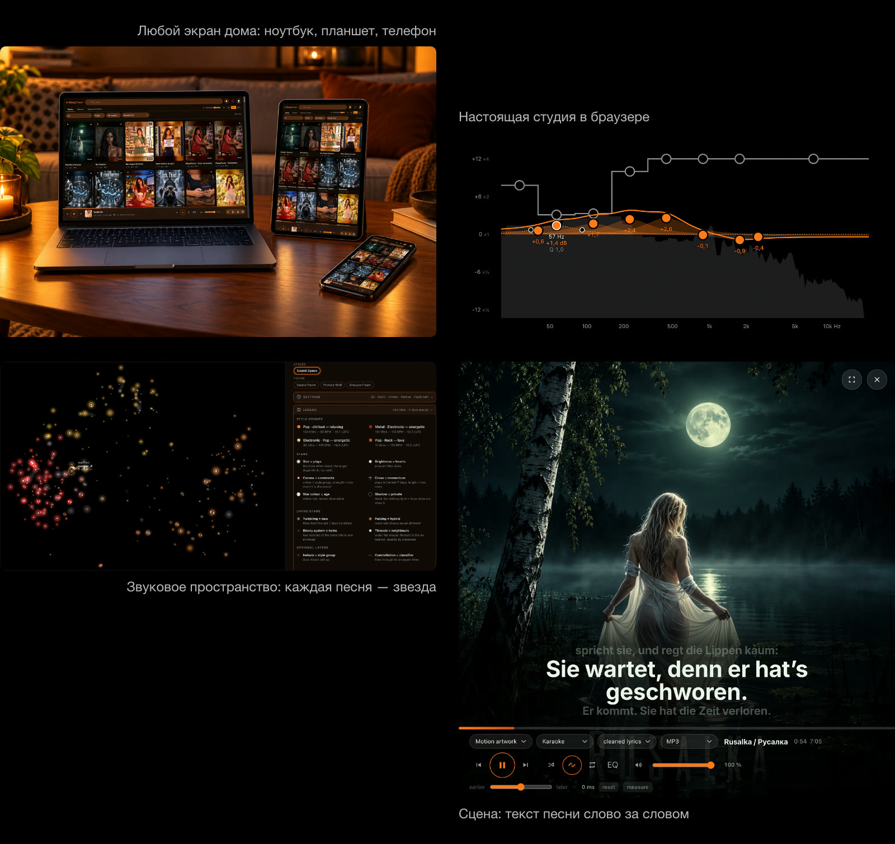

# KlangTresor #

[Deutsch](README.de.md) · [English](README.md) · **Русский**

<a href="https://caspardavi.github.io/klangtresor/features/?lang=ru"></a>

**[Что умеет KlangTresor → страница возможностей](https://caspardavi.github.io/klangtresor/features/?lang=ru)**\
Брошюра в PDF: [для экрана (8 МБ)](https://caspardavi.github.io/klangtresor/features/KlangTresor-Broschuere-ru.pdf) · [для печати (70 МБ)](https://github.com/CasparDavi/klangtresor/releases/download/broschuere-2026-10-28/KlangTresor-Broschuere-ru-druck.pdf)

*Сейф для вашей музыки: то, что в нём лежит, принадлежит вам, а ключ есть только у вас.*

**Локальный архив ваших собственных песен на [Suno](https://suno.com)** — с
текстами, промптами, обложками, плейлистами и метаданными. К нему прилагается сайт,
который работает в домашней сети и играет на любом экране с браузером.

<br>

<a href="https://caspardavi.github.io/klangtresor/features/?lang=ru"></a>

<br>


За ним стоит набор инструментов, который считывает из ваших треков всё, что
поддаётся измерению: громкость по EBU R128, тональность по басу,
диапазон голоса, дорожки инструментов, студию звука с эквалайзером и
компрессором, звёздную карту вашего звукового пространства.

**Работает на штатных средствах Node.** Без базы данных, без регистрации (кроме вашего
собственного входа в браузере), с единственной npm-зависимостью (и та нужна только для
распознавания музыкального стиля).

---

> **Документы разложены по модулям** — карта к ним находится в
> [docs/LIESMICH.md](docs/LIESMICH.md) (на немецком).

## Чем это *не* является

Чтобы не возникло недоразумений:

- **Это не клиент Suno и не способ обойти API.** Всё, что доступно публично без входа,
  запрашивается публично. Всё остальное — приватные песни, временные метки слов,
  плейлисты — забирает закладка в вашей собственной вкладке браузера, где вы вошли в Suno.
  Доступ остаётся там, где ему и место: на suno.com.
- **Это не способ обойти условия Suno.** Архив сохраняет ваши собственные работы,
  а не чужие.
- **Это не сервис.** Он работает на вашем компьютере, в вашей сети,
  без аккаунта и без сервера в интернете.
- **Это не готовое приложение.** Оно создано под один архив и выросло вместе с ним.
  Тем, кто хочет им пользоваться, стоит уметь работать с командной строкой.

---

## Права и участие

Код распространяется по **лицензии MIT** — см. [LICENSE](LICENSE). Это значит:
берите его, меняйте, передавайте дальше, стройте на нём что-то своё.
Единственное условие — уведомление об авторских правах должно идти вместе с кодом.

**Последнее слово о том, что войдёт в этот проект, остаётся за Caspar_D.** Это не
условие лицензии, а просто следствие того, кому принадлежит репозиторий:
предложения приветствуются, но объединяется то, что объединит он. Кто хочет иначе,
может в любой момент сделать форк — для этого лицензия и существует.

Чужие компоненты и ИИ-модели эта лицензия не охватывает. Что откуда взято и на что
при этом нужно обратить внимание, написано в
[web/fremd/LIZENZEN.md](web/fremd/LIZENZEN.md). Одно ограничение стоит выделить:
модели для распознавания музыкального стиля распространяются по лицензии CC BY-NC-ND,
и коммерческое использование для них запрещено.

Песни, тексты и обложки в созданном с его помощью архиве принадлежат
их авторам и не являются частью этого репозитория.

## Как это возникло

Значительная часть этого кода написана в диалоге с языковой ИИ-моделью.
Замысел, отбор, проверка и все решения по оформлению принадлежат Caspar_D — это можно
прочитать в [docs/haus/HAUSREGELN.md](docs/haus/HAUSREGELN.md), где у каждого правила
указан его повод, и в истории версий.

Это написано здесь, потому что так и было и потому что документы так или иначе об этом
рассказывают. Тем, кто хочет узнать, как рождается такая вещь, в
[docs/haus/HISTORY.md](docs/haus/HISTORY.md) расскажут и о заблуждениях.

---

## Что он умеет

**Архив**
- Все ваши песни локально — MP3 и WAV, обложки, видеообложки
- Плейлисты с сохранением порядка; чужие песни в них воспроизводятся с CDN
- Даже неопубликованное, если оно есть в вашем собственном плейлисте
- Комментарии и реакции — с людьми, которые за ними стоят

**Слушать**
- Караоке-сцена с текстом, который идёт слово в слово, и полноэкранным режимом
- Цветовые палитры из каждой обложки — интерфейс окрашивается под играющую песню,
  не придумывая ни одного цвета
- Семь собственных визуализаций, а также Butterchurn с 333
  пресетами MilkDrop

**Измерять**
- Громкость по EBU R128 с обоими порогами, True Peak, динамический диапазон
- Тональность по басу на сильной доле, лад по сосчитанной
  терции — а там, где терции нет, указан только основной тон
- Диапазон голоса методом YIN на выделенной вокальной дорожке
- Разделение на шесть дорожек инструментов, локально и без Python
- Временные метки слов и транскрипт из whisper.cpp

**Инструменты**
- Студия звука с эквалайзером, компрессором, помещением и режекторным фильтром помех
- **Пространства**: ваша коллекция в виде звёздной карты с траекториями полёта — в
  двух видах. **Звуковое пространство** упорядочивает песни по звучанию, **Пространство
  историй** — по тому, о чём они (по текстам, многоязычно: немецкие и английские
  тексты попадают в одно пространство, без перевода). Его группы называются по
  **словам-местам**: словам из вашего собственного собрания, которые «живут» там,
  где лежит группа; группа без определённой области честно об этом сообщает
- Страница автора: ваши собственные цифры в сравнении с окружением —
  кто здесь комментировал, ставил лайки или подписывался, с публичными
  цифрами профилей и индексом Хирша. С объяснением, почему в этом расчёте
  почти каждый оказывается в нижней трети

---

## Установка

Дважды щёлкните скрипт установки для вашей системы:
`einrichten-macos.command`, `einrichten-windows.cmd` или
`einrichten-linux.sh`. Он загружает недостающее — Node.js, пакеты,
ИИ-модели и Whisper, в Windows также ffmpeg (на Mac и в Linux ffmpeg
ставится через менеджер пакетов) — всего около 4,7 ГБ. Затем он спрашивает
ваше имя в Suno, загружает публичный список песен, забирает файлы Suno,
которые уже лежат на компьютере, загружает обложки и анимированные обложки
и запускает KlangTresor. Каждый шаг описан в [START-RU.md](START-RU.md).

То, что доступно только после входа, — неопубликованные треки, альбомы,
пословные метки времени, уже разблокированные аудиофайлы, — затем загружает
закладка «KlangTresor morgens». Её адрес находится в утреннем окне за
красной кнопкой.

### В Windows

**Setup.exe** (RU\*): скачайте [KlangTresor-Setup.exe](https://github.com/CasparDavi/klangtresor/releases/latest/download/KlangTresor-Setup.exe) и дважды кликните. Установщик показывает, что уже есть,
загружает ffmpeg, ИИ-модели и Whisper с индикатором прогресса и затем открывает браузер — остаётся только имя в Suno.
После этого KlangTresor работает как значок справа внизу на панели задач. При первом запуске Windows трижды
переспрашивает, потому что Setup.exe не подписан; куда нажимать, с картинками показано в [START-RU.md](START-RU.md).

Старый путь через zip по-прежнему работает:


Дважды кликните **`einrichten-windows.cmd`** — остальное выполнится
само: проверит, чего не хватает, загрузит Node.js и пакеты, загрузит модели, спросит
ваш псевдоним в Suno, соберёт песни и запустит программу. Установка открывается
как страница в браузере; если браузер не открылся, она работает в окне как текст.

`.cmd` вызывает `bin\anlasser.ps1` — саму `.ps1` не запускайте.
На многих компьютерах Windows её отклоняет, а окно закрывается раньше,
чем успеешь прочитать сообщение, — и кажется, что программа сломана.
`.cmd` обходит и то и другое: она держит окно открытым и разрешает
скрипт только для этого одного запуска, не меняя ничего в системных настройках.

Если ffmpeg не хватает, скрипт подскажет, как его добавить: одной строкой через
`winget`, а для компьютеров без `winget` — по шагам вручную.

### В WSL

Если сервер работает в среде Linux, браузер тоже должен работать там —
Chrome, запущенный в Windows, до него не дотянется. Всё
остальное работает, только закладка не находит сервер.

---

## Повседневная работа

Красная кнопка вверху справа забирает всё новое: сначала показывает, потом
применяет. Вход в аккаунт ей не нужен.

Для того, что видно только после входа, — временные метки слов, приватные
песни, плейлисты, кто отреагировал — есть **закладка**. Она
работает в вашей вкладке Suno, сразу сохраняет и отправляет собранное
пакетами на сервер. Ключ доступа при этом никогда не попадает
на диск.

Цифры окружения собирают два запуска; их можно запустить из панели
*Окружение* на странице автора или вручную:

```
node bin/community-profile.js    цифры профилей людей, которые здесь встречаются
node bin/community-hirsch.js     их индексы Хирша (занимает заметно больше времени)
```

Оба забирают только то, чего ещё не хватает, так что повторный запуск ничего не стоит.
Они читают данные публично и без входа — и при этом соблюдают
правила обхождения из [docs/haus/HAUSREGELN.md](docs/haus/HAUSREGELN.md): один запрос
за раз, пауза 1,5 с, честный User-Agent, а если сервис
притормаживает запросы — немедленная остановка.

---

## Установка обновления

Красная кнопка забирает данные песен, а не код. Новые версии программы
лежат на [GitHub](https://github.com/CasparDavi/klangtresor). Есть ли там
новая, KlangTresor проверяет сам: при открытии страницы и, пока
она открыта, каждые 12 часов (после неудачи — через 2
часа) страница опрашивает ваш собственный сервер — а также каждый раз, когда открывается окно
«KlangTresor» (клик по названию вверху). Сервер спрашивает GitHub и
хранит ответ полчаса. Если там номер выше, слева от красной кнопки появляется колокольчик;
клик по нему открывает окно с подсказкой: какая версия готова,
в какой папке работает KlangTresor и
какой скрипт устанавливает обновление. **Показать папку** открывает эту папку в
файловом менеджере (только на компьютере, где работает KlangTresor, не в контейнере). Замороженная
копия на флешке никогда не спрашивает.

Для установки, находясь в **папке проекта** (там лежат `bin/` и `library/`,
на один уровень выше `docker/`):

```bash
./aktualisieren-linux.sh          # Mac: aktualisieren-macos.command
                                  # Windows: aktualisieren-windows.cmd
```

Из подпапки: `npm run aktualisieren` (npm находит `package.json`
выше по дереву). Только посмотреть, ничего не записывая:

```bash
npm run aktualisieren -- --nur-stand
```

- **Git-клон:** `git pull --rebase origin main` (прерывается при несохранённых
  изменениях или если ветка не `main`). Файлы из пакета обновления,
  скопированные в папку, процессу не мешают. Если история не родственна
  истории на GitHub (клон со времён MySuno), берётся
  zip из релиза; несохранённые изменения перед этим откладываются в `git stash`.
- **Установка из zip:** загружает `KlangTresor.zip` последнего релиза и
  накладывает программные данные поверх.
- **Docker:** после этого `compose up --build`. `library/` — это том и
  остаётся. Оверлей CUDA — только если в работающем контейнере
  уже есть `KLANG_CUDA`.
- **Без Docker:** если изменился `package-lock.json` — `npm ci`, затем
  перезапустите сервер через `starten-*`.

`library/`, `werkzeug/` и `.git/` остаются нетронутыми.

---

## Старые версии без скрипта обновления

До версии 1.0.72 — и со времён, когда программа называлась *MySuno* —
в папке ещё нет скрипта обновления. Поэтому к каждому релизу приложен
пакет обновления, всегда в самой свежей версии:

```
https://github.com/CasparDavi/klangtresor/releases/latest/download/KlangTresor-Update.zip
```

Скопируйте `aktualisieren.js` и скрипт для вашей системы в вашу папку
KlangTresor или MySuno (туда, где лежит `library/`) и дважды кликните
по скрипту:

| Система | что копировать | как запускать |
|---|---|---|
| Windows | `aktualisieren.js`, `aktualisieren-windows.cmd` | двойной клик по `aktualisieren-windows.cmd` |
| macOS | `aktualisieren.js`, `aktualisieren-macos.command` | двойной клик по `aktualisieren-macos.command` |
| Linux | `aktualisieren.js`, `aktualisieren-linux.sh` | `./aktualisieren-linux.sh` |

Пакет плоский, без подпапок: при копировании Finder заменяет
существующую папку `bin/`, а не объединяет её с новой. Затем обновление
идёт как обычно — `library/` остаётся, — после чего в папке лежат все
`aktualisieren-*`, а копия `aktualisieren.js` удаляет себя
сама. Начиная с версии 1.0.73 пакет не нужен.

При первом запуске система поворчит, что пакет не подписан:
Windows скажет «Не удалось проверить издателя» —
нажмите **Выполнить**. macOS скажет «неизвестный разработчик» — в первый
раз правый клик → **Открыть**; начиная с macOS 15 этого там больше нет,
тогда Системные настройки → Конфиденциальность и безопасность → **Всё равно открыть**.
Linux: если нет права на выполнение, `chmod +x aktualisieren-linux.sh`.

Кто запускает KlangTresor только в контейнере, без Node на компьютере,
пакет не нужен: скопируйте содержимое нового `KlangTresor.zip` в
папку (заменяйте файлы, но никогда всю папку целиком — в ней
лежит `library/`) и ещё раз запустите `einrichten-docker-*`. Если там ещё работает
контейнер `mysuno` со времён MySuno, сначала выполните `docker stop mysuno`.

---

## Если у вас уже есть установка

До 24.08.2026 программа называлась *MySuno*. Обновление устанавливается так,
как описано в разделе [Старые версии без скрипта обновления](#старые-версии-без-скрипта-обновления),
и ничего не теряется:

- **Настройки сохраняются.** Эквалайзер, громкость, вид визуализации,
  вид карты — все 52 ключа хранилища в браузере называются так же,
  как раньше. Их переименование сбросило бы всё у каждого пользователя,
  а наружу они ничего не обозначают.
- **Архив сохраняется.** `library/` не затрагивается, формат хранения
  не изменился, ни одна конечная точка сервера не пропала.
- **Папка может называться как угодно.** Все скрипты работают
  относительно самих себя; переименовывать ничего не нужно.

Две вещи меняются заметно:

**Анализы будут пересчитаны один раз.** После удаления старого
метода определения тональности хранилища несут метку способа измерения. Если у вас остались
анализы, сделанные до этого, при следующем открытии они пересчитаются — один раз,
потом всё спокойно.

**Пять видов визуализации исчезли.** `audioMotion` распространялся по AGPL
и не совместим с лицензией MIT этого проекта. Если у вас был выбран один из его
видов, при следующем запуске он будет заменён на **Спектр** —
те же столбики частот, только радиально, а не на базовой линии.

После обновления один раз перезапустите сервер.

---

## Что нужно сохранять

**`library/katalog.json.gz`** — около 47 МБ. В нём всё, что
нельзя восстановить из файла: тексты, временные метки слов, комментарии
с ответами, история счётчиков за месяцы, плейлисты.

Кроме того, `library/roh/`, если там что-то лежит.

> **Внимание: эта инструкция долго была неверной.** В ней `library/roh/` называлась
> единственным незаменимым. Когда-то это было так —
> сегодня `aufbereiten.js` убирает обработанные исходные данные, как только
> их содержимое попадает в каталог (так и задумано: «зачем это таскать с собой и
> расходовать место»). Поэтому в исправной работе папка почти
> пуста, и кто сохраняет только её, не сохраняет ничего.

Всё остальное — медиа, обложки, плитки, палитры, анализы — заново строит
`node bin/wiederherstellen.js`, без какого-либо входа.

**Но две вещи оно не вернёт:** оригиналы WAV
(`node bin/wav.js` — **с 03.09.2026 не работает**, путь через
`cdn1.suno.ai` закрыт, см. `docs/suno/AUDIO-BEZUG.md`) и
дорожки инструментов (их заново рассчитывает утренний прогон, не дольше получаса за утро, сначала новые). Кто хочет
их сохранить, должен сразу копировать и `library/songs/` — но это
уже много десятков гигабайт.

---

## Структура папок

```
einrichten-windows.cmd         установка в Windows (двойной клик)
einrichten-macos.command       установка на Mac (двойной клик)
einrichten-linux.sh            установка в Linux
einrichten-docker-*            то же без установки - всё в контейнере
aktualisieren-*                обновление до новой версии с GitHub (Git или zip)
starten-windows.cmd / -macos.command / -linux.sh   только запуск, без установки
docker/    Dockerfile, docker-compose.yml, входной скрипт контейнера
bin/       сбор, обработка, измерение, цвета, восстановление
  einrichten.js  установка в десять шагов; melden.js передаёт ей цифры
browser/   скрипты для консоли Suno и закладки
server/    сайт для домашней сети, порт 8788
web/       весь интерфейс в одном файле
  einrichtung/  страница установки (полоса, галочки, итоговые цифры)
  fremd/   Analyzer, Butterchurn
library/   каталог, исходные данные, медиа — не в репозитории
docs/      специальные документы
```

---

## Документация

| | |
|---|---|
| [docs/archiv/UEBERGABE.md](https://github.com/CasparDavi/klangtresor/blob/main/docs/archiv/UEBERGABE.md) (на немецком) | Введение, процессы, подводные камни |
| [docs/haus/HAUSREGELN.md](docs/haus/HAUSREGELN.md) | Правила оформления, каждое — с поводом |
| [docs/analyse/NORMEN.md](docs/analyse/NORMEN.md) | Нормы громкости, пороги, целевые уровни |
| [docs/analyse/VISUALIZER.md](docs/analyse/VISUALIZER.md) | Сцена, анализ, правила отображения |
| [docs/analyse/FARBHANDLING.md](docs/analyse/FARBHANDLING.md) | Извлечение цвета, цветовые пространства, каждое правило с измеренным значением |
| [docs/ton/TONSTUDIO.md](docs/ton/TONSTUDIO.md) | Эквалайзер, компрессор, помещение |
| [docs/ton/EINMESSEN.md](docs/ton/EINMESSEN.md) | Калибровка в точке прослушивания: сигналы, порядок, оценка, результаты |
| [docs/suno/WHISPER.md](docs/suno/WHISPER.md) | Временные метки слов из распознавания на слух |
| [docs/suno/WEGE.md](docs/suno/WEGE.md) | Пути веб-API — что мы используем, что стоит использовать, что меняет аккаунт |
| [docs/forschung/VERGLEICH-HUB.md](docs/forschung/VERGLEICH-HUB.md) | Сравнение функций со смежным инструментом — есть ли это у нас, лучше ли, или отвергнуто? |
| [docs/haus/ZUSAMMENARBEIT.md](docs/haus/ZUSAMMENARBEIT.md) | Работа вдвоём над репозиторием: проверять чужие коммиты, прежде чем подтягивать |
| [docs/BACKLOG.md](https://github.com/CasparDavi/klangtresor/blob/main/docs/BACKLOG.md) | Что ещё открыто — и что отвергнуто, с обоснованием |
| [docs/haus/HISTORY.md](docs/haus/HISTORY.md) | Хронология, включая все заблуждения |

Специальные документы возникли на архиве их автора
([@caspar_d](https://suno.com/@caspar_d)) и приводят его
измерения и примеры. Тем не менее они описывают программу, а не
коллекцию — цифры служат подтверждением принятых
решений.

Кто хочет узнать, почему что-то устроено так, а не иначе, найдёт
ответ чаще всего в комментарии прямо в исходном коде. Это
намеренно: обоснования не уходят в файл, который никто
не открывает.

---

## Ограничения

- **Разрабатывалось на macOS** с Chrome и Safari; в Linux и WSL
  работало у тестировщиков.
- Скрипты сбора привязаны к интерфейсам Suno. Если Suno что-то изменит,
  `browser/01-erkundung.js` поможет подстроиться.
- На дисках exFAT каждый маленький файл занимает целый блок в 1 МБ —
  поэтому вся мелочь лежит в сводных файлах.
- Для разделения на дорожки нужна модель объёмом 246 МБ
  (`npm run modelle`); считается примерно за удвоенное реальное время.

---

## Об имени

До 24.08.2026 проект назывался *MySuno*. От имени отказались,
потому что **SUNO** с 06.01.2026 является зарегистрированным товарным знаком Suno Inc.
([US-Reg. 8096778](https://tsdr.uspto.gov/statusview/sn98407583)) — причём
прямо для *«downloadable software to enable users to edit
and playback of audio content»*, то есть именно для такого рода программ. Международная
регистрация IR 1930809 от 22.05.2026 указывает также
Германию и ЕС.

Чужой товарный знак в **названии** проекта — вопрос щекотливый; упоминать его в
**описании** — нет, поэтому вверху по-прежнему написано,
для чего это нужно. Где в цитатах и в `docs/haus/HISTORY.md` ещё стоит
старое имя, оно остаётся: сказанное однажды задним числом не переписывают.

Ключи хранилища в браузере (`mysuno-…`), CSS-класс
`.sunoanalyzer` и `window.SunoAnalyzer` тоже по-прежнему носят старое имя.
Их переименование сбросило бы сохранённые настройки у каждого пользователя,
а наружу они ничего не обозначают.
