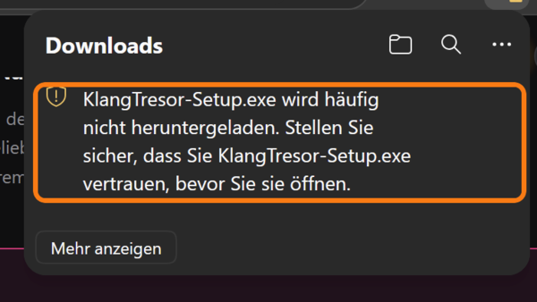
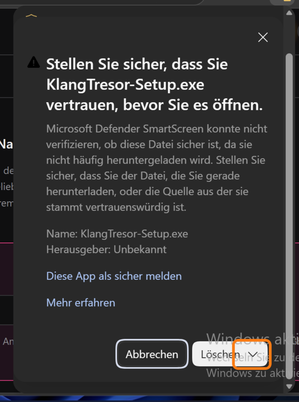
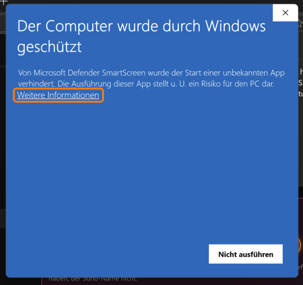
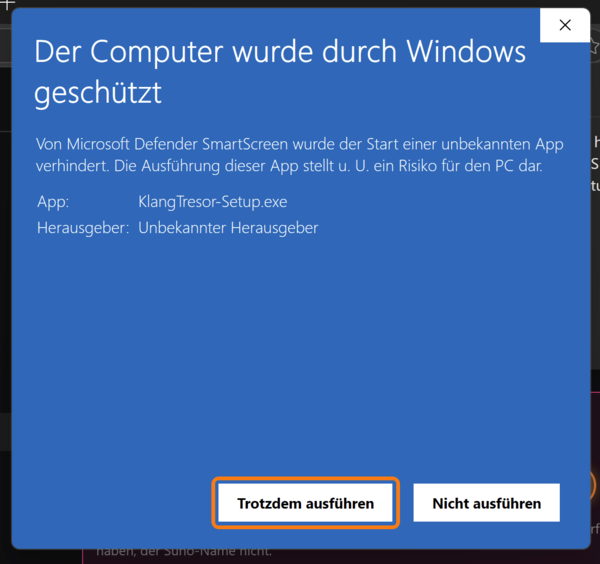

# KlangTresor — for your own Suno archive

[Deutsch](START-HIER.md) · **English** · [Русский](START-RU.md)

> **Name change:** Until 24 Aug 2026 the project was called *MySuno*. It is now called **KlangTresor** — "Suno" has been a registered trademark of Suno Inc. since 6 Jan 2026, expressly for software that plays and edits audio content. Wherever quotations and the chronicle still carry the old name, it stays.

This is a local archive of the songs you have published on Suno.
It downloads your music, artwork, lyrics and playlists to your computer
and gives you a website for them that runs on your own Wi-Fi — on iPhone
and iPad too.

Everything stays with you: no cloud, no account except your Suno login,
no database. What you start here runs on your computer and talks only
to Suno — in one direction, read-only.

**You do not have to enter or adjust anything.** The program recognises
your Suno account by itself as soon as you collect once.

---

> **The documents are sorted by module** — the map is in
> [docs/LIESMICH.md](docs/LIESMICH.md) (German).

## Windows: the Setup.exe — download, double-click, done

For Windows 10 and 11 there is an installer:

    https://github.com/CasparDavi/klangtresor/releases/latest/download/KlangTresor-Setup.exe

It puts KlangTresor into `C:\Users\<name>\KlangTresor`, shows what is already there, fetches ffmpeg, the AI models and
Whisper with progress bars and then opens the browser — there you only enter your Suno name. After that KlangTresor runs
as an **icon at the bottom right of the taskbar**: double-click opens the page, right-click → Quit. No administrator
rights needed. If a KlangTresor is already there, only the program is renewed; your archive stays.

**Windows asks three times — that is normal.** The Setup.exe is not signed, and Windows does not know it yet. The
screenshots are from a German Windows; the orange mark is always where you click:

**1. Edge, right after downloading:** "… isn't commonly downloaded". Hover over the entry, click the three dots **…**
next to it → **Keep**.



**2. The follow-up question:** "Make sure you trust KlangTresor-Setup.exe before you open it". "Keep anyway" is not a
button of its own — it hides behind the **small arrow ˅ next to "Delete"**.



**3. When opening it:** "Windows protected your PC". Click the link **More info** …



**4. … then *Run anyway* appears.**



Removing: Settings → Apps → KlangTresor, or Start menu → "KlangTresor entfernen". Your archive (`library`) and the AI
models (`modelle`) stay; the last page says where and how big.

For macOS the zip stays for now (the section after next); an installer of its own is in the works.

## Linux: the AppImage — download, make executable, double-click

For Linux on regular PCs (x64) there is a single file:

    https://github.com/CasparDavi/klangtresor/releases/latest/download/KlangTresor-x86_64.AppImage

1. **Make it executable** (once): right-click the file → Properties → switch on "Executable as Program".
   In a terminal: `chmod +x KlangTresor-x86_64.AppImage`.
2. **Double-click.** KlangTresor places itself in `~/KlangTresor`, adds itself to the applications menu and opens the
   setup in the browser: ffmpeg, the AI models and Whisper are fetched with progress bars, then only your Suno name.
3. After that KlangTresor runs as an **icon in the panel** (top right on Ubuntu): Open, Show log, Quit. Where the panel
   shows no such icons, quit KlangTresor in the app under **Profile → System**.

A newer AppImage renews the program on start; your archive stays. No sudo, no package manager. Tested on Ubuntu 24.04.

## The zip way — macOS, Linux, Docker (and Windows without the Setup.exe)

The package is available here, always in the latest version:

    https://github.com/CasparDavi/klangtresor/releases/latest/download/KlangTresor.zip

Unzip it — this creates a folder `KlangTresor`, one level, no folder inside a
folder. The setup scripts are inside. **One** of them is enough — find
the line for your system and your route:

| your system | the usual way | with Docker |
|---|---|---|
| **Windows** | double-click `einrichten-windows.cmd` | double-click `einrichten-docker-windows.cmd` |
| **macOS** | double-click `einrichten-macos.command` | double-click `einrichten-docker-macos.command` |
| **Linux** | `./einrichten-linux.sh` | `./einrichten-docker-linux.sh` |

There is nothing more in there: six setup files, plus `starten-*` for later and `aktualisieren-*` for new versions.
Each has three stages, and each catches the next — first your system's script fetches
Node.js (if it is missing), then `bin/einrichten.js` takes over and
opens the setup **as a page in the browser**: a list of steps,
a progress bar, explanations, buttons instead of keyboard shortcuts. If no
browser opens, the same thing carries on in the window as text — you can answer
in either place. If you only want the text: append `--text`.

**The first time you double-click, your system will grumble — that is normal**, the package is
not signed, and the source code lies open right next to it.

- **Windows** shows "Open File – Security Warning: The publisher could not be
  verified. Are you sure you want to run this software?" — with
  "Unknown publisher" and a red shield below it. Click **Run**. If you untick
  "Always ask before opening this file", you will not see the question again for this file.
- **macOS** says "unverified developer" — right-click once → Open.
  From macOS 15 on there is no "Open" there any more: then go to System Settings →
  Privacy & Security → **Open Anyway**.

For **starting later**, the setup puts a shortcut "KlangTresor" on your
desktop — with an icon; it starts the server and opens the
browser (Chrome, if you have it). If you delete it, take `starten-windows.cmd`,
`starten-macos.command` or `starten-linux.sh` from the folder — they set
nothing up any more, they only start.

### Installing an update

The red button fetches new *titles* from Suno. A new *version* of the program
comes from GitHub. KlangTresor checks by itself — when you open the page
and, as long as it stays open, every 12 hours (2 hours after a failure),
and also every time the "KlangTresor" window opens (click on the
name at the top). The server asks GitHub itself, and it remembers an answer for half an hour; the
frozen copy on the stick never asks.
If there is a new one, a bell appears to the left of the red button; a click
opens the window with the details: which version is ready, in which
folder KlangTresor is running and which script installs the update.
**Show folder** opens that folder in the file window — only on the computer
where KlangTresor is running. In the container there is no such thing: there the
window tells you to go to the project folder on your computer.

To install it, in the same folder as the setup (where `bin/`
and `library/` are, not the subfolder `docker/`):

| your system | file |
|---|---|
| **Windows** | double-click `aktualisieren-windows.cmd` |
| **macOS** | double-click `aktualisieren-macos.command` |
| **Linux** | `./aktualisieren-linux.sh` |

Git clone: it pulls `origin/main`. Zip installation: it fetches
`KlangTresor.zip` from the latest release and lays the program files
over the old ones. **`library/` stays** — titles, pictures, sound. If KlangTresor runs
in Docker, the image is rebuilt (`compose up --build`); the NVIDIA
overlay stays if the container already uses `KLANG_CUDA`.

Unsaved changes and a Git branch other than `main` stop the
script. Afterwards reload the page once with a hard refresh; without Docker, restart the server
via `starten-*`.

### Older versions without an update script

Up to version 1.0.72 — and from the time when KlangTresor was still called *MySuno* —
the folder has no `aktualisieren-*` yet. For that there is the update package,
always in the latest version:

    https://github.com/CasparDavi/klangtresor/releases/latest/download/KlangTresor-Update.zip

Copy `aktualisieren.js` and the script for your system into your
KlangTresor or MySuno folder (where `library/` is) and double-click
the script.

| your system | copy these two | then |
|---|---|---|
| **Windows** | `aktualisieren.js` and `aktualisieren-windows.cmd` | double-click `aktualisieren-windows.cmd` |
| **macOS** | `aktualisieren.js` and `aktualisieren-macos.command` | double-click `aktualisieren-macos.command` |
| **Linux** | `aktualisieren.js` and `aktualisieren-linux.sh` | `./aktualisieren-linux.sh` |

Copy only the files, do not replace any folders. The package deliberately has
no subfolder: when copying, the Finder replaces an existing folder
`bin/` instead of merging it — your old program would be gone.

After that the update runs as usual: **`library/` stays**, the program
is renewed, and afterwards all `aktualisieren-*` files are in the folder. The
copy `aktualisieren.js` removes itself after the first successful run;
for the next update a double-click is enough. From version 1.0.73 on you do not need
the package — the script is already included.

**The first time you start it, your system grumbles**, just as with the setup:

- **Windows**: "The publisher could not be verified" — **Run**.
- **macOS**: "unverified developer" — the first time, right-click →
  **Open**. From macOS 15 on there is no "Open" there any more: then
  System Settings → Privacy & Security → **Open Anyway**.
- **Linux**: if the script does not start, it lacks the execute permission —
  `chmod +x aktualisieren-linux.sh`, or `bash aktualisieren-linux.sh`.

A **Git clone** pulls `origin/main` as usual; Git itself brings along
the files you copied in. If the Git history does not come from GitHub (a
clone from the MySuno days), the release zip is used instead — `.git/`
stays, and unsaved changes are put in the `git stash` beforehand.

**Docker only, without Node on the computer:** then the package does not help, it
needs Node. Copy the contents of the new `KlangTresor.zip` into your folder
(replace files, never the whole folder — `library/` is inside it) and
start `einrichten-docker-*` once more. If a container `mysuno`
from the MySuno days is still running, run `docker stop mysuno` first.

On Windows the PowerShell scripts live in `bin\` and are called by the
`.cmd` files — **do not** click them yourself: many computers refuse
scripts, and the window closes before you can read the message
— you would then think the program is broken. The `.cmd` avoids both.
(Contributed by Casto, who stumbled over exactly this.)

**The usual way** needs no preparation. If Node.js is missing, it fetches it
itself — as a portable version into the project folder, with no entry in the system and
without administrator rights.

**First the question of where.** If your computer already has an archive — even an
old *MySuno*, whatever the folder is called — it is found and offered first:
then only the program is renewed, and your titles, pictures and
audio files stay. The search covers the area next to the unzipped folder, your
user folder, Downloads, the desktop, Documents and Music, two
levels deep each; it is recognised by the catalogue, never by the name. If your old archive
is on a different drive, you pick the folder yourself via "Elsewhere".

**Then eleven steps, and each says what it does:**

1. Check the folder — write permission, no administrator rights, space (about 4.7 GB).
2. What is already here? Archive, ffmpeg, packages, AI models, port — with sizes, what
   is missing and will be fetched. Afterwards you know what you are waiting for.
3. ffmpeg — fetched on Windows, via the package manager on Mac and Linux.
4. The building blocks of the server (19 packages).
5. The AI models (16 files, about 1.2 GB).
6. Whisper — program and model for the lyrics that run along (about 3.1 GB).
7. Your Suno name — the only input.
8. Your song list: titles, lyrics, styles, albums.
9. Suno files you have already downloaded are recognised and sorted in.
10. Cover images and moving images. The longest step — and the only one you can
   safely cancel: "Start now, the rest later" fetches the rest while you use the program.
11. Finally: what only you can fetch yourself, and why.

Cancelling is allowed everywhere; the next start fetches only what is missing.
If something sticks, everything is in plain text behind the **Log** tab.

All download addresses are in [`quellen.txt`](quellen.txt), one line per
item. If a provider moves, you change the line there — and nobody has to search
in a script.

**The Docker way** is for everyone who does not want to install anything: Node and
ffmpeg then live in the container, and nothing of them is left on your computer.
Your archive still stays outside, on the disk (`library/`) — you can throw
the container away and rebuild it, the music stays. And from then on it starts again
by itself with the computer.

One thing the container cannot see: the folders of your computer. If your
Suno files are already somewhere, "Choose a folder …" therefore opens the folder window
of your browser — the page recognises the files by their contents and takes over what is
missing. KlangTresor does not remember a folder chosen this way; if something new lands there later,
you choose it again.

All you need is Docker — and which one is right depends on the system.
**The script tells you** when it is missing: on the Mac the version for your
processor (Apple Silicon or Intel), on Windows first WSL 2 and then Docker
Desktop, on Linux the Docker **Engine** (not Desktop) along with the two
steps that are easily forgotten there — starting the service and adding yourself
to the group `docker`. If Docker is there but not running, the
script offers to start it and wait.

After the Docker start you carry on **in the browser**: enter your alias at the top
right, then press the red button — it fetches the song list, downloads the
media and computes the analyses. After that you need no terminal any more.

If you prefer to go step by step or want to know what the scripts do,
just keep reading — they do exactly what is written below.

---

## What you need

- [**Node.js**](https://nodejs.org) — the LTS version is enough (20 or later)
- [**ffmpeg**](https://ffmpeg.org) — Mac: `brew install ffmpeg`,
  Linux: `sudo apt install ffmpeg` (or your package manager),
  Windows: `winget install ffmpeg` (or from ffmpeg.org, then add the
  `bin` folder to the PATH) — afterwards reopen the terminal
- Disk space: about 15 MB per song, with WAV about 70 MB

Once, in the unzipped folder — this fetches the only package the
program needs (the AI runtime for the Sound Space), and the models:

```bash
npm install
node bin/modelle-holen.js
```

Nothing else: no database, no Python, no Docker. Runs the same on Mac,
Linux and Windows (PowerShell).

If fetching the models reports "fetch failed", your computer cannot reach
the sources (proxy, certificate, DNS). The script then tries `curl` itself
and otherwise tells you exactly which files to open in the browser and
under which name to save them in `library/modelle/` —
then run `node bin/modelle-holen.js` once more; anything already there is
skipped.

You do **not** need a browser for the start any more.

---

## Step 1 — Collect

Open a terminal in the unzipped folder, then — **instead of `dein-handle`, put in the
name after the `@` on your Suno profile page**:

```bash
node bin/sammeln.js dein-handle
```

That is it. No signing in, no browser console, no copying: Suno's
profile interface answers without a token and delivers the complete
song data including lyrics. The program stores the raw file itself in the
right place.

At the end it tells you what it found — and the second time also
what is **new** compared with what you already have.

---

## Step 2 — Build everything

```bash
node bin/wiederherstellen.js
```

This fetches your MP3s and artwork from Suno's server, computes the tiles
and pulls a colour palette out of each cover. Depending on the size of your collection
it takes a few minutes. You can cancel and restart it at any time —
only what is missing is fetched again.

---

## Step 3 — Listen

```bash
node server/server.js
```

Or double-click the shortcut "KlangTresor" on your desktop
— or **`starten-windows.cmd`**, **`starten-macos.command`**,
**`starten-linux.sh`** in the folder: the same thing, just without typing.

The addresses are in the output: on the computer itself
`http://localhost:8788`, on iPhone and iPad the address with the
numbers. Both devices must be on the same Wi-Fi. Quit with `Ctrl+C`.

**The window stays open as long as you listen.** The server runs in it;
closing it ends the server — and with it everything the red button is
currently computing. Minimising is fine.

**Keyboard:** Space pauses, left/right arrow switches the song,
up/down arrow adjusts the volume, `m` mutes. On the
Stage additionally `f` for full screen and `Esc` to close.

**In the footer** on the left are Back, Play and Next, then
tile and title, then Shuffle and Loop, the volume, and on the right
three buttons for the Stage:

| | |
|---|---|
| **Microphone** | Karaoke — the text runs along word by word |
| **Text block** | Lyrics — the whole song on a split screen |
| **Bars** | Analysis — see below |

A click on the **tile** opens the Stage the way you last had it. If a button is grey,
the song lacks the prerequisite — without word timestamps no karaoke,
without text no lyrics.

**Whisper, your wish:** For songs for which Suno gives no timestamps,
KlangTresor computes them afterwards with Whisper `large-v3` — overnight, newest
first. If the button then says "Karaoke (Whisper)", the timestamps are
heard, not aligned by Suno. How to set it up on your machine
(much faster with a GPU): `docs/suno/WHISPER.md`.

---

## Optional — the WAV originals

For every song Suno also keeps a lossless version ready, but
only once it has been requested. Whether it exists yet is told to
you by:

> **Since 3 Sep 2026 this no longer works.** `bin/wav.js` fetches the WAV via
> `cdn1.suno.ai/<id>.wav`, and that route is closed — like all direct audio links
> at Suno, even for the owner. The script therefore stands idle. A **403**
> today very much does mean "blocked". `bin/gesundheit.js` watches over it,
> the status is in `docs/suno/AUDIO-BEZUG.md`. The section below describes the
> state of August and stays as a report.

```bash
node bin/wav.js --pruefen
node bin/wav.js              # fetches everything that is ready
```

How to trigger missing ones is described in `WAV-PROTOKOLL.md` — for that
you need the browser once. A WAV weighs about 50 MB; in the Stage you can
switch between MP3 and WAV at the top.

---

## The analysis mode

The third Stage button opens an analysis of the song that is playing. It
computes on your computer and asks nothing anywhere on the net.

At the top are **data-based suggestions for improvement**, switchable
per platform — Streaming, Spotify, Apple Music, YouTube, Club,
Broadcast. They set side by side what the platform demands and what
your song has: loudness, peak, loudness range, full-scale hits,
phase.

Two things that are easily confused:

**Less negative means louder.** −11.8 LUFS is above a target of
−14, not below. The headroom before clipping is a different
quantity — the true peak.

**Too loud is no fault with streaming.** The title is turned down
on playback. All that is lost is the dynamics that were traded away earlier
for the limiter.

Below that a **timeline with the findings**: where peaks lie above the
target, where the phase cancels out, where one tone sticks out
permanently — every marker is clickable, and the song jumps there. The
top lane shows the sections of your text, in the colours of the
Suno editor.

Further down are curves for loudness, energy, dynamics, tempo, pitch,
stereo image and two spectrograms. For each curve you can set the
weighting profile and the window length at the bottom — the small icons
show the shape of the window itself.

---

## What the bookmark does

Because this is asked again and again: Suno hands out your own,
**unpublished** songs only to someone who is signed in. A program on
your computer is not — the sign-in key belongs to the browser and to the
address `suno.com`, and Suno does not allow any other site to read it.

The bookmark therefore runs **in a Suno tab**, right where the key
lies anyway. With it, it fetches the list of your songs including their addresses and
sends it to your KlangTresor. Everything else — music, covers, videos — is then loaded by the
red button itself, because these addresses work even without signing in,
if you know them.

It is a **one-way street**: it only reads. Nothing goes back to Suno, not even
play counts.

If you get the message that the sign-in is not reachable: the bookmark
belongs on a tab of **suno.com** (not on KlangTresor), the page must have finished
loading, and you must be signed in there. Since 23 Aug 2026 it waits
up to eight seconds for the sign-in instead of giving up at once.

## Later: fetching new songs — the red button

At the top right of the album view sits a **red button**. Press it
in the morning:

1. It asks Suno and shows you **what has changed** —
   new songs, changed ones, and which ones got new plays, likes or comments.
   With tile and number. Nothing changes yet.
2. Below that a **selection list** of what the run should do — in three
   groups: with login (only via the bookmark), public from Suno
   (comments, media), local (catalogue, analysis, Whisper, music style
   and Sound Space). Normally everything is on.
3. **Apply** then pulls it all in. The button spins while it
   runs; you can close the window and keep listening.

You no longer need the terminal for this. The two commands from above
still do the same, in case you prefer them.

**What the button cannot do**, because it needs your sign-in: your
word timestamps for karaoke, private songs, playlists, and who has liked your
songs. For that there is the **bookmark** — the button
explains it to you and gives you the address to copy. Create it once in Chrome,
then click it on any Suno page where you are signed
in. Your password is not stored anywhere in the process.

---

## The spaces — your archive as a starry sky

The third tab. **There are two spaces**, switchable in the header:

| | Closeness means | made from |
|---|---|---|
| **Sound** | sounds similar | the audio |
| **Stories** | is about similar things | the lyrics |

The Stories space needs **no translation**: the model maps
more than a hundred languages into the same space, German and English texts
lie side by side when they are about similar things. Songs without text
are missing there — the legend says so, too. Its topic groups
are named after the **place words** — words from your own songs
that live where the group lies; a group without a clear place is honestly called
"(mixed country)". The space carries a **(beta)**: it is
young and is still being refined.

On the Sound space in detail: a music AI (Discogs-EffNet, from the Essentia
people in Barcelona) listens to every song all the way through and gives it a
place in the Sound Space: closeness = similar sound, independent of the
style prompt. Along with that, genre, mood and instruments for each song. From this a
starry sky in 3D is made — click a star to play it, "Start journey" lets
the sound ship fly from neighbour to neighbour.

The red button computes this (step "Music style and music map",
about 6–10 seconds per song on the CPU) or you do it by hand:

```bash
node bin/klang.js
node bin/karte.js
```

If you have an **NVIDIA card** (Linux or Windows, CUDA 12 + cuDNN 9
installed), `KLANG_CUDA=1 node bin/klang.js` computes on the GPU —
much faster; in PowerShell: `$env:KLANG_CUDA=1; node bin/klang.js`.
If it does not work, it says so and takes the CPU.

"Export" in the Sound Space panel writes `library/export/sternenhimmel.html`
— a single file with a player that you can send around; it shows
only public songs and runs without a server (sound and covers come from
Suno).

---

## Karaoke timestamps with Whisper

Suno's own word timestamps come via the bookmark. For songs that have
none (or as a second track), the program computes them itself with
[whisper.cpp](https://github.com/ggml-org/whisper.cpp). **The setup
installs it** (`bin/whisper-holen.js`): the ready-made program on Windows
and Linux; on the Mac it is built — macOS asks once for its developer
tools — plus the large-v3 model (3.1 GB). Existing installations fetch it
on the next morning run; if the download breaks off, it continues where
it stopped.

Only if you want to use an NVIDIA card (a song in seconds instead of
minutes) do you build whisper.cpp yourself with `-DGGML_CUDA=1` and tell
the program where it is before starting:

```bash
export WHISPER_CLI=/path/to/whisper.cpp/build/bin/whisper-cli
export WHISPER_MODELL=/path/to/whisper.cpp/models/ggml-large-v3.bin
```

If Whisper is still missing, the red button skips the step with a
message — everything else keeps working.

---

## Who is listening — likes and comments

Every tile now has a **thumb** and a **speech bubble**
with numbers. Click one, and a window opens at the mouse: the
course of plays, likes and comments over the days, who has liked
(as far as Suno reveals it — the last four weeks), and **all
comments with replies**, in full text, with emojis. A click on a
name shows you where else that person has commented.

The comments are saved on every morning run — even if
someone deletes theirs later, it stays with you.

---

## Sorting and searching

The **sort menu** now also contains things the program has measured from the
audio: Fastest first, Slowest first, Loudest first, Most dynamic first,
Widest stereo … They appear only once your songs have been
computed through — that happens by itself on the morning run.

Next to the **search field** sits a small **Filter** menu. It knows:
model, key, major/minor, voice, year, month, who has commented,
and what is still missing. Pick a key, and you are offered only the
values that really exist in your archive — with counts.
A click puts them into the field; several can be combined.

---

## What you should back up

**`library/katalog.json.gz`** — about 47 MB. Everything is in there that
does not come back from a file: lyrics, timestamps, comments, the
counter history, the playlists. Plus `library/roh/`, if something is
lying there at the moment — the folder is usually empty, because `aufbereiten.js`
clears away the processed raw data as soon as its contents are in the catalogue.

---

## Two things you should know

**Other people's songs in your playlists** are not copied,
but fetched directly from Suno when they play. They are marked **remote**
and need the internet. Everything that belongs to you is stored
locally and also works without a network.

**Your own unpublished songs** come into the archive if they are in
one of your playlists. They carry the mark **private**, and in the
filter at the top you can choose between *Public*, *Private* and *Both*.

---

## If something sticks

- **`sammeln.js` finds nothing:** Then the handle is wrong — it must be
  written exactly as after the `@` on your profile page,
  without the `@` itself.
- **Songs are missing:** Run it again — Suno throttles requests that come too
  fast, the program notices and tells you.
- **The iPhone cannot reach the page:** Are both devices on the same Wi-Fi?
  And at the first start your computer's firewall asks whether Node may accept
  connections — that must be allowed.
- **Suno has changed something:** Run `browser/01-erkundung.js` in the
  browser console; it shows which interfaces still
  answer.
- **npm warns "install scripts not yet covered by allowScripts":**
  Not an error, and nothing is missing. Since npm 11, npm wants to know which
  packages may run their own scripts during installation — a consequence
  of the attacks smuggled in through npm packages. KlangTresor has exactly one
  of them: `onnxruntime-node` uses it to fetch the AI runtime for the
  Sound Space. The approval has been in the
  `package.json` since 27 Aug 2026. If you still see the message, your version is
  older — download it again, or run
  `npm approve-scripts onnxruntime-node` once. With npm 11
  everything runs meanwhile, it is only a warning; from npm 12 npm blocks
  without the approval.

<details><summary>The old way via the browser console</summary>

If Suno ever closes the profile endpoint, this still works:

```bash
node bin/sammelskript.js
# Adresse öffnen, Rechtsklick → Untersuchen → Console,
# Inhalt von browser/02-sammeln-aktuell.js hineinkopieren, Enter.
# Die heruntergeladene Datei dann:
mv ~/Downloads/suno-archiv-metadaten.json \
   library/roh/profil-$(date +%Y-%m-%d-%H-%M-%S).json
node bin/wiederherstellen.js
```
</details>

More background is in [README.md](README.md) and in detail in
`docs/`. The specialist documents arose from the archive of Caspar_D
([@caspar_d](https://suno.com/@caspar_d)) and use his
figures as examples — but they describe the program, not his
collection.

Have fun with it.
